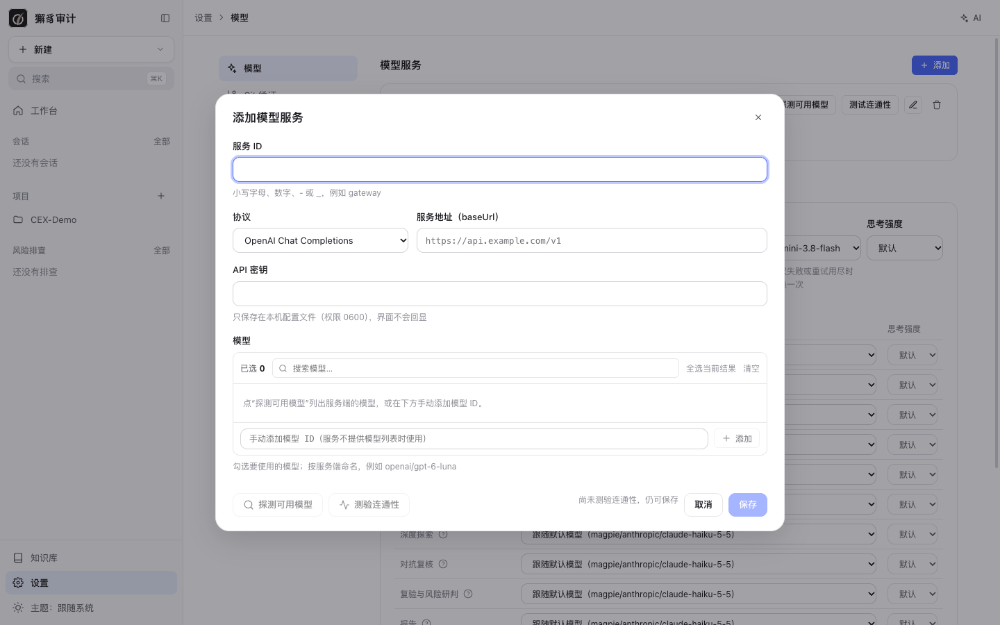

# 1. 安装与首次配置

[← 返回目录](README.md)

## 环境要求

| 依赖 | 要求 | 用途 |
| --- | --- | --- |
| Node.js | 22.19 或更高 | 运行时 |
| ripgrep（`rg`） | 必需 | 代码检索 |
| git | 可选 | Git 来源仓库、增量审计 |
| gopls / jdtls / pyright / typescript-language-server | 可选 | 更精确的符号查询；缺少时退化为 tree-sitter，审计中会记录 `INDEX_DEGRADED` |

支持审计的语言：Java、Go、Python、JavaScript / TypeScript（服务端）、PHP、Kotlin、C#、Ruby、Rust。

## 安装

```bash
npm install -g xiezhi-audit@alpha
```

安装过程不编译任何原生模块。

## 环境诊断

```bash
xiezhi doctor
```

`doctor` 逐项检查 Node 版本、数据目录权限、SQLite、磁盘空间、`rg`、`git`、tree-sitter 语法与规则数，以及可选的语言服务器。缺少的工具会给出安装命令。示例输出：

```text
OK    node         26.7.0
OK    sqlite       journal_mode=delete
OK    rg           /opt/homebrew/bin/rg ripgrep 15.2.0
OK    git          /usr/bin/git git version 2.50.1 (Apple Git-155)
OK    tree-sitter  java 0.23.5, go 0.25.0, …; 344 条规则
INFO  pyright      未找到 pyright-langserver（可在设置中指定 tools.pyrightPath） — 影响：符号查询退化为 tree-sitter
```

数据目录权限不是 `700` 时，`doctor` 会给出 `WARN` 和修复命令（`chmod 700 <数据目录>`）。启动服务后，Web 界面的 [设置 › 系统诊断](10-settings.md#系统诊断) 也能看到同样的检查结果。

## 数据目录

- 默认是 `~/.xiezhi-code-audit`。
- 可以用全局参数 `--data-dir DIR` 或环境变量 `XIEZHI_AUDIT_DATA_DIR` 修改。
- 数据库、代码快照、索引、会话、日志、模型密钥和 Git 凭证都保存在这里。

## 启动 Web 工作台

```bash
xiezhi serve
```

- 服务只监听 `127.0.0.1`，默认端口 4820，可以用 `--port N` 修改。
- 加 `--open` 会用系统默认浏览器打开工作台。环境变量 `XIEZHI_AUDIT_BROWSER` 可以指定浏览器程序的绝对路径。
- 终端会打印一次性登录链接，形如 `http://127.0.0.1:4820/#boot=…`。

## 登录 Web 工作台

为了防止其他网页冒用本机服务，浏览器只能通过一次性链接登录：链接 5 分钟内有效，只能用一次。直接打开工作台地址，或者链接过期、服务重启后，会看到下面的提示页：


在另一个终端运行下面的命令，获取新的登录链接：

```bash
xiezhi open
```

## 配置模型服务

首次使用要先配置至少一个模型服务。打开 **设置 › 模型**，点 **添加**：



| 字段 | 说明 |
| --- | --- |
| 服务 ID | 小写字母、数字、`-`、`_`，例如 `gateway`。模型引用格式为 `服务ID/模型ID`。 |
| 协议 | `OpenAI Chat Completions`、`OpenAI Responses` 或 `Anthropic Messages`。 |
| 服务地址（baseUrl） | 例如 `https://api.example.com/v1`，本地网关可以写 `http://127.0.0.1:3425/v1`。 |
| API 密钥 | 只保存在本机配置文件（权限 0600），界面不会回显。 |
| 模型 | 点 **探测可用模型** 列出服务端的模型，勾选要用的；服务不提供模型列表时，可以手动输入模型 ID 添加。 |

保存前可以点 **测验连通性**，检查地址、密钥和每个模型是否可用；没有测验也可以保存。

保存后，在同一页的 **模型配置** 区域设置：


- **默认模型**：各阶段没有单独指定时都用它。
- **备用模型**：任一阶段的模型不存在、鉴权失败或重试用尽时切换到它；每个作业最多切换一次。
- **思考强度**：默认 / 关 / 低 / 中 / 高，可以分别为默认模型和备用模型设置。
- **各阶段模型**：计划与画像、影响范围、风险假设、初筛、深入审计、归并、深度探索、对抗复核、复验与风险研判、报告等阶段可以分别选模型，点 `?` 查看每个阶段的作用。
- **多模型交叉**：选 2–4 个模型，指定的环节由每个模型各做一遍，用于交叉复核。

也可以用命令行配置（等价于上面的界面操作）：

```bash
xiezhi config add-provider magpie --api openai-completions --base-url http://127.0.0.1:3425/v1 --models anthropic/claude-haiku-5-5,antigravity/gemini-3.8-flash
```

```bash
xiezhi config set-secret magpie
```

```bash
xiezhi config set defaultModel magpie/anthropic/claude-haiku-5-5
```

```bash
xiezhi config set fallbackModel magpie/antigravity/gemini-3.8-flash
```

## 私有 Git 仓库凭证（可选）

要拉取私有 HTTPS 仓库，在 **设置 › Git 凭证** 中按域名添加 token，或用命令行：

```bash
xiezhi config set-git-credential gitlab.example.com --username oauth2
```

详见 [设置 › Git 凭证](10-settings.md#git-凭证)。

下一步：[2. 工作台与界面导航](02-workspace.md)
