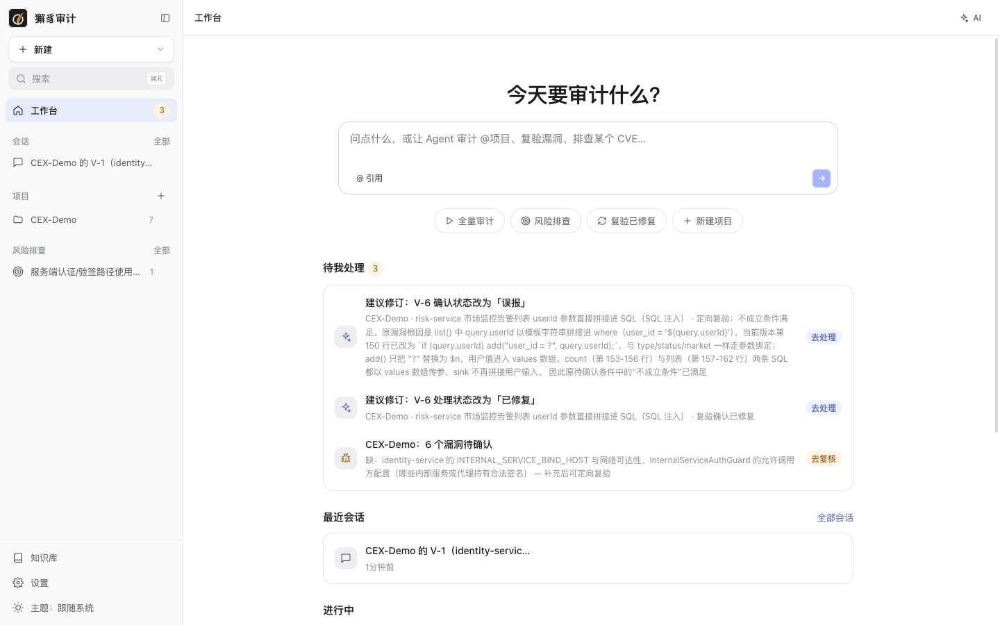
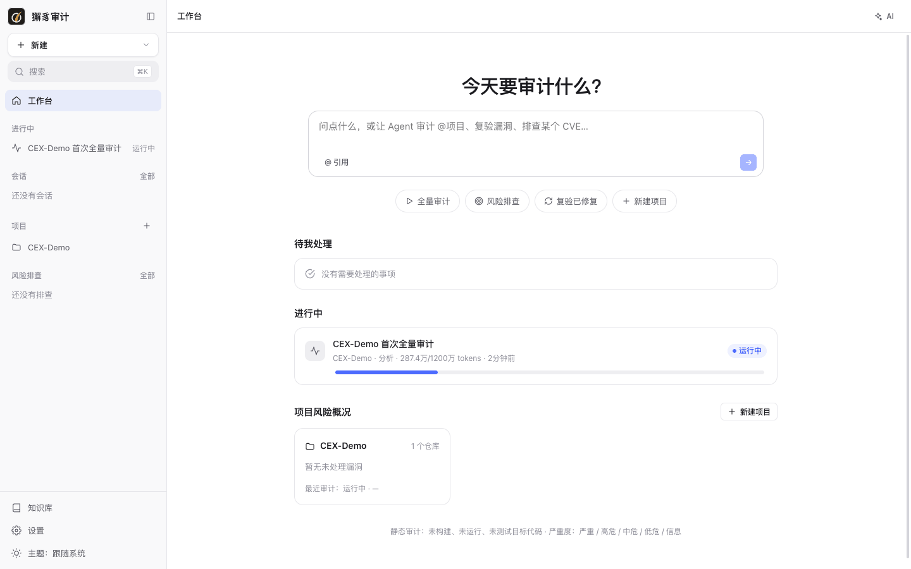
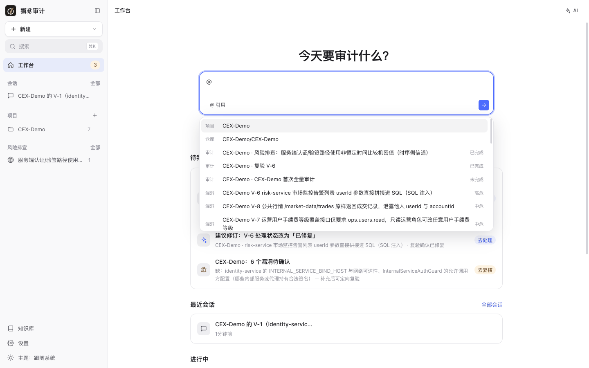
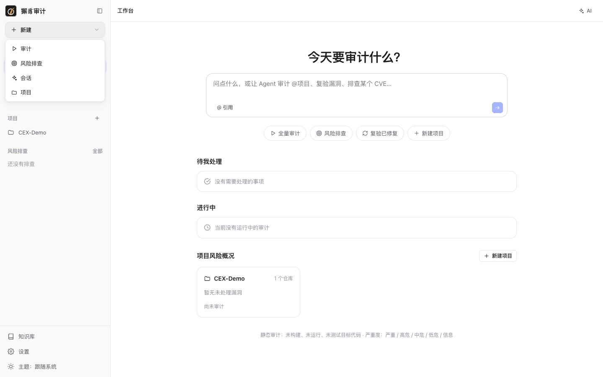
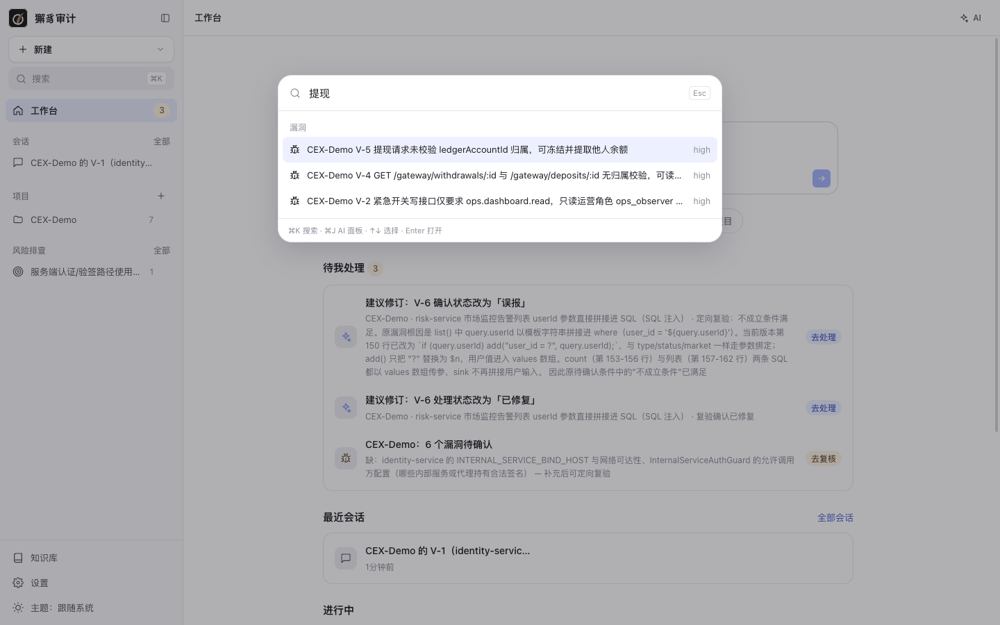
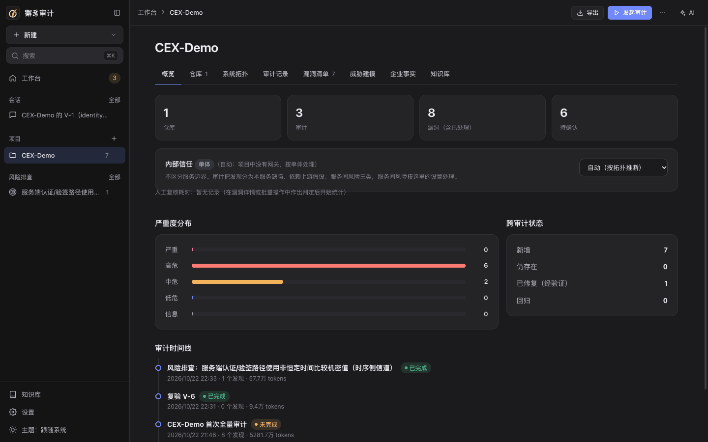

# 2. 工作台与界面导航

[← 返回目录](README.md)

## 首页（工作台）

登录后进入工作台：

| 区域 | 作用 |
| --- | --- |
| 输入框 | 用自然语言提问，或者让 Agent 审计、复验、排查。输入 `@` 可以引用项目、仓库、审计、漏洞或知识。提交后在右侧 AI 面板中开始一个[会话](08-conversations.md)。 |
| 快捷按钮 | **全量审计**、**风险排查**、**复验已修复**、**新建项目**。 |
| 待我处理 | 需要你处理的事项，例如待确认的漏洞（“去复核”）、复验后的建议修订（“去处理”）、Agent 提问和预算不足提醒。 |
| 最近会话 | 最近的 AI 会话，点 **全部会话** 进入会话列表。 |
| 进行中 | 正在运行的审计和进度条。 |
| 项目风险概况 | 每个项目一张卡片：仓库数、各严重度的未处理漏洞数、最近一次审计和覆盖情况。 |

审计运行时，“进行中”区域会显示审计名称、阶段、token 用量和耗时：

在输入框里输入 `@`，会弹出引用候选（项目、仓库、审计、漏洞），选中后作为本次提问的上下文：

## 侧栏

| 位置 | 内容 |
| --- | --- |
| **新建** | 下拉菜单：审计、风险排查、会话、项目。 |
| **搜索 ⌘K** | 打开全局搜索。 |
| **工作台** | 回到首页，数字徽标是“待我处理”的数量。 |
| **进行中** | 正在运行的审计（运行时才出现）。 |
| **会话** | 最近的 AI 会话，点“全部”查看所有会话。 |
| **项目** | 项目列表，数字是未处理漏洞数。悬停时出现菜单：发起审计、重命名、归档、删除项目。 |
| **风险排查** | 最近的排查任务，点“全部”查看所有排查。 |
| **知识库** / **设置** | 全局知识库与系统设置。 |
| **主题** | 在“跟随系统 / 浅色 / 深色”之间切换。 |

左上角的按钮可以折叠侧栏。

## 全局搜索（⌘K）

按 `⌘K`（Windows / Linux 上是 `Ctrl+K`）打开搜索，可以搜索项目、审计、漏洞等对象。用 `↑` `↓` 选择，`Enter` 打开，`Esc` 关闭。

## AI 面板（⌘J）

每个页面右上角都有 **AI** 按钮，也可以按 `⌘J`（`Ctrl+J`）打开或关闭。AI 面板会按当前页面的对象续接会话：

- 在审计页面打开时，是这次审计的“审计会话”，Agent 的提问和你的介入都在这里。
- 在项目或漏洞页面打开时，会自动引用当前项目或漏洞。
- 在其他页面打开时，是通用会话。

面板顶部可以查看历史会话、新建会话，或在独立页面打开当前会话。详见 [8. AI 会话](08-conversations.md)。

## 深色主题

侧栏底部的 **主题** 可以切换为深色：

## 页面底部提示

工作台底部始终标注“静态审计：未构建、未运行、未测试目标代码”，以及严重度分级：严重 / 高危 / 中危 / 低危 / 信息。

下一步：[3. 项目与仓库](03-projects.md)
