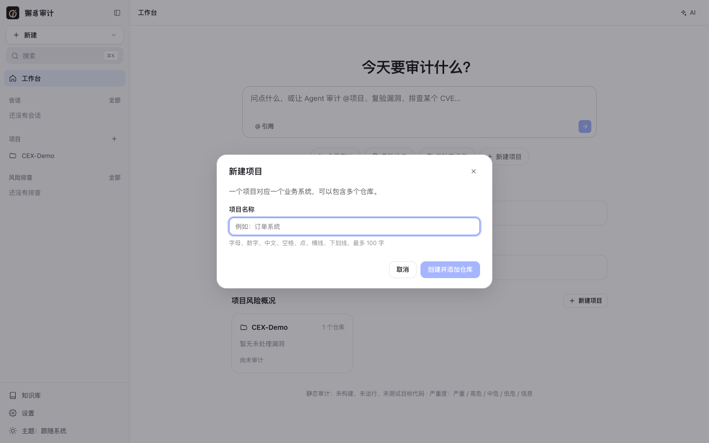
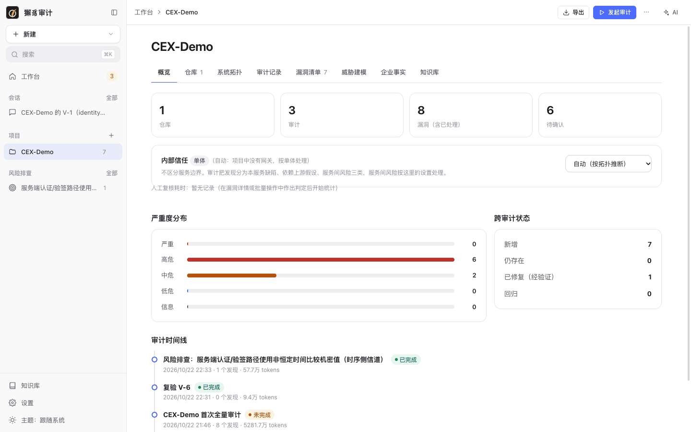
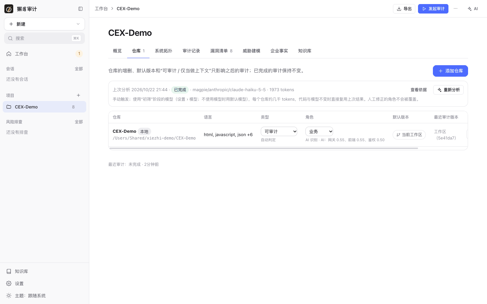
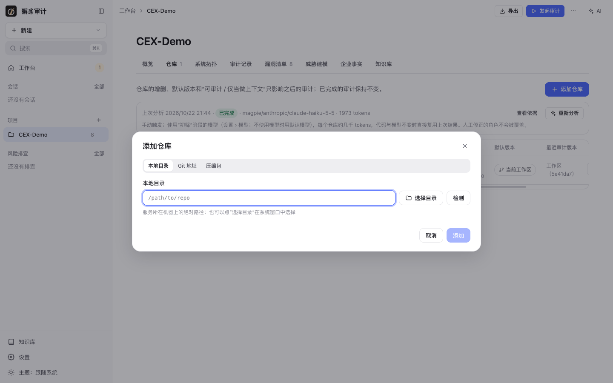
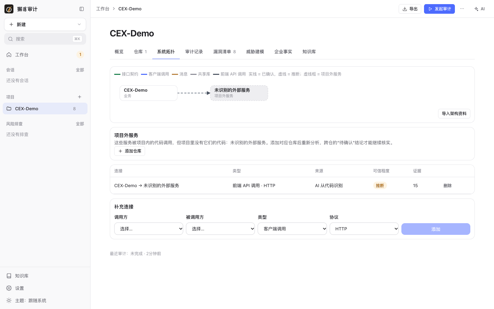
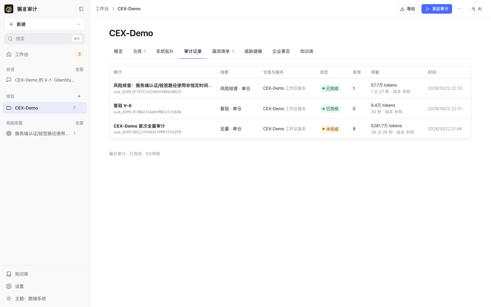
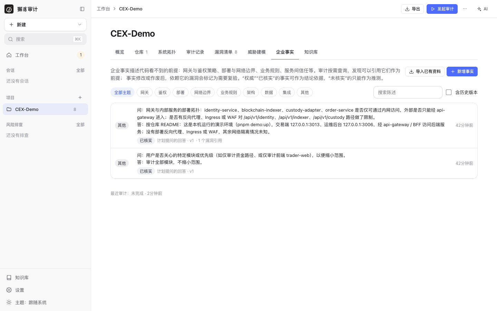
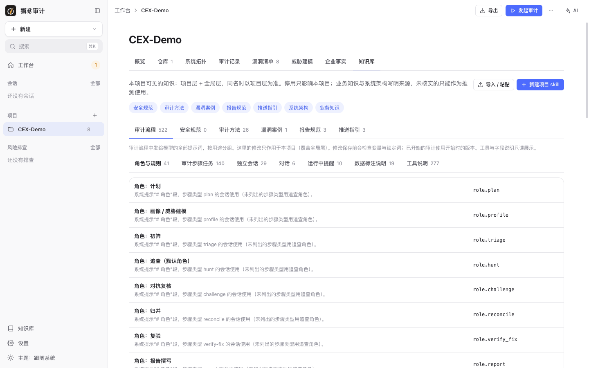
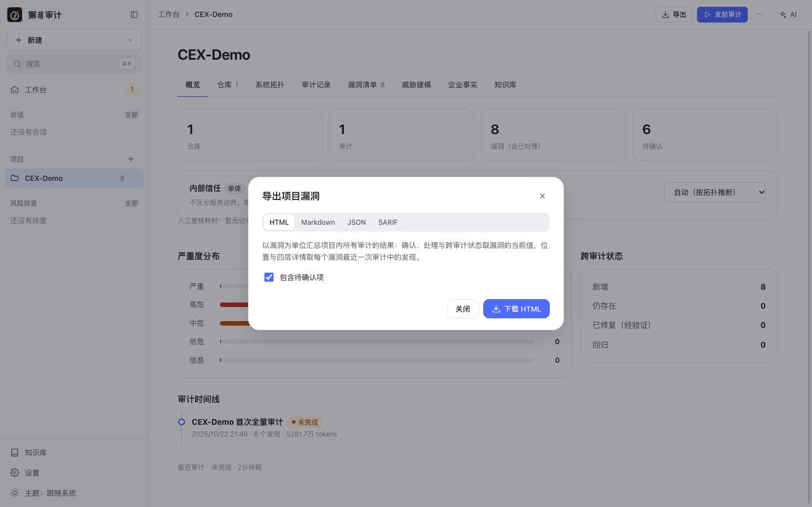

# 3. 项目与仓库

[← 返回目录](README.md)

一个**项目**对应一个业务系统，可以包含多个仓库。漏洞、审计记录、威胁模型、企业事实和项目知识都挂在项目下。

## 新建项目

在首页点 **新建项目**，或在侧栏 **新建 › 项目**、侧栏“项目”旁的 **+**：



项目名称支持字母、数字、中文、空格、点、横线和下划线，最多 100 字。点 **创建并添加仓库** 后会直接打开添加仓库对话框。

命令行：

```bash
xiezhi project create CEX-Demo
```

## 项目页面

项目页面顶部有 **导出**、**发起审计** 和更多菜单（`…`），下方是八个标签页：

| 标签 | 内容 |
| --- | --- |
| 概览 | 仓库、审计、漏洞、待确认数量；内部信任设置；严重度分布；跨审计状态；审计时间线 |
| 仓库 | 仓库列表、类型、角色、默认版本，AI 识别仓库角色 |
| 系统拓扑 | 仓库之间的调用关系图 |
| 审计记录 | 本项目的全部审计 |
| 漏洞清单 | 见 [5. 漏洞管理](05-vulns.md) |
| 威胁建模 | 见 [6. 需求威胁建模](06-threat-models.md) |
| 企业事实 | 代码中看不到的环境前提 |
| 知识库 | 项目级知识（覆盖或补充全局知识） |

### 概览



- **统计卡片**：仓库数、审计数、漏洞数（含已处理）、待确认数。
- **内部信任**：决定“服务间风险”如何发布。审计把发现分为本服务缺陷、依赖上游假设、服务间风险三类。
  | 设置 | 含义 |
  | --- | --- |
  | 自动（按拓扑推断） | 默认值，按系统拓扑推断。例如项目中没有网关时按“单体”处理。 |
  | 零信任 | 每个服务自己校验；服务间风险照常作为漏洞发布。 |
  | 网关为边界 | 经网关的请求视为已认证；只能从内部到达的服务间风险降一级发布。 |
  | 内网可信 | 内网调用互信；服务间风险作为提示列出，不发布为漏洞。 |
- **人工复核耗时**：在漏洞详情或批量操作中做出判定后开始统计。
- **严重度分布**、**跨审计状态**（新增、仍存在、已修复（经验证）、回归）。
- **审计时间线**：全量审计、复验、风险排查按时间排列，显示发现数和 token 用量。

## 仓库



| 列 | 说明 |
| --- | --- |
| 仓库 | 名称、来源（本地 / Git / 压缩包）和路径 |
| 语言 | 自动识别 |
| 类型 | **可审计**：可以作为审计对象；**仅当做上下文**：只作为跨仓确认的证据，不产生自己的发现。默认自动判定。 |
| 角色 | 网关、鉴权、业务、接口定义、前端、共享库、未识别。下方小字是 AI 识别结果和置信度；置信度低时保持“未识别”，可以手动选择。人工修正的角色不会被 AI 覆盖。 |
| 默认版本 | 默认审计的分支、标签或“当前工作区”。 |
| 最近审计版本 | 上一次审计的 commit。 |
| 审计 | 对这个仓库直接发起审计。 |

仓库的增删、默认版本和类型只影响之后的审计，已完成的审计保持不变。

### 添加仓库

点 **添加仓库**：



三种来源：

| 来源 | 说明 |
| --- | --- |
| 本地目录 | 服务所在机器上的绝对路径，可以点 **选择目录** 用系统窗口选择，**检测** 用于验证路径。 |
| Git 地址 | `https://…` 或 `git@host:path`，可以指定分支 / 标签。私有 HTTPS 仓库需要先配置 [Git 凭证](10-settings.md#git-凭证)。 |
| 压缩包 | zip / tar / tar.gz。 |

命令行：

```bash
xiezhi project add-repo CEX-Demo --path /path/to/CEX-Demo
```

```bash
xiezhi project add-repo CEX-Demo --git https://github.com/org/repo.git --ref main
```

```bash
xiezhi project add-repo CEX-Demo --archive repo.zip
```

### AI 识别仓库角色

仓库列表上方的 **重新分析**会让 AI 识别每个仓库的角色和仓库之间的调用关系。分析是手动触发的，使用“初筛”阶段的模型（未设置时用默认模型），每个仓库约几千 tokens；代码和模型都没变时直接复用上次结果。点 **查看依据** 可以看到 AI 的判断理由。

命令行：

```bash
xiezhi project analyze CEX-Demo
```

## 系统拓扑



- 拓扑图中，实线表示已确认，虚线表示推断，虚线框表示项目外的服务。
- 连接类型：接口契约、客户端调用、消息、共享库、前端 API 调用；协议：HTTP、gRPC、Dubbo、MQ、网关路由、依赖。
- 连接表列出每条连接的类型、来源（如“AI 从代码识别”）、可信程度（推断 / 确认）和证据数，可以删除错误的连接。
- **补充连接**：手动选择调用方、被调用方、类型和协议后添加。
- **导入架构资料**：导入已有的架构文档，补充拓扑。

审计时，Agent 会用拓扑做跨仓调用追踪。上图中 CEX-Demo 是一个 monorepo，只有一个仓库，AI 从代码里识别出它调用了一个项目外的服务（虚线框）。可以用 **添加仓库** 把这个服务的代码也加进来，跨仓的结论就能从“待确认”变为可判定。

## 审计记录



列出本项目的全部审计：场景（全量 / 增量 / 复验 / 风险排查）、模式（单仓 / 多仓）、仓库与版本、状态、发现数、token 用量和耗时。点标题进入审计详情。

## 企业事实

企业事实描述代码看不到的前提：网关与鉴权策略、部署与网络边界、业务规则、服务间信任等。审计会按需查询它们，发现可以引用事实作为前提。



- 事实按主题分类：网关、鉴权、部署、网络边界、业务规则、架构、数据、集成、其他。
- **权威 / 已核实** 的事实可以作为结论依据，**未核实** 的事实只能作为推测。
- 事实修改或作废后，依赖它的漏洞会被标记为需要复验。
- 来源：你回答 Agent 提问时选择“回答存为事实”、漏洞复核中的 **复核裁定存为事实**、手动 **新增事实**，或 **导入已有资料**。
- 勾选 **含历史版本** 可以查看事实的修改历史。

上图中的两条事实来自审计计划阶段对 Agent 提问的回答：一条是部署拓扑（引用自仓库 README），已被 1 个漏洞引用；另一条是审计范围。

## 项目知识库



项目可见的知识 = 项目层 + 全局层，同名时以项目层为准。停用只影响本项目。适合写业务专属的知识，例如业务规则、系统架构和安全规范。用法与 [全局知识库](09-knowledge.md) 相同。

## 导出项目漏洞

项目页面右上角的 **导出**：



以漏洞为单位汇总项目内所有审计的结果：确认、处理与跨审计状态取漏洞的当前值，位置与详情取每个漏洞最近一次审计中的发现。支持 HTML、Markdown、JSON、SARIF，可以选择是否包含待确认项。

下一步：[4. 代码审计](04-audits.md)
