# 4. 代码审计

[← 返回目录](README.md)

审计是獬豸的核心功能。一次审计会固定代码版本、建立结构索引、生成计划、画像与威胁建模、初筛候选、深入追查、补齐覆盖、对抗复核、归并结论，最后生成报告。整个过程不构建、不运行、不测试目标代码。

## 审计场景与模式

| 场景 | 说明 | 从哪里发起 |
| --- | --- | --- |
| 全量审计 | 审计仓库的全部代码 | 新建审计、首页、项目页 |
| 增量审计 | 只审计相对基线有变更或受变更影响的范围，单仓库 | 新建审计 |
| 风险排查 | 针对特定风险跨项目快速排查 | [风险排查](07-risk-hunts.md) 页面 |
| 漏洞复验 | 针对已有漏洞做定向验证 | [漏洞详情或清单](05-vulns.md#复验) |

| 模式 | 说明 |
| --- | --- |
| 单仓库审计 | 一个目标仓库，可以加**关联仓库**作为跨仓确认的依据（网关、鉴权服务、接口定义等），关联仓库不产生自己的发现。 |
| 多仓库合并审计 | 多个仓库地位平等，发现可以落在任一仓库，调用链可以跨仓库。默认包含全部可审计仓库。 |

## 新建审计

从首页 **全量审计**、侧栏 **新建 › 审计**、项目页 **发起审计**，或仓库列表的 **审计** 按钮进入：

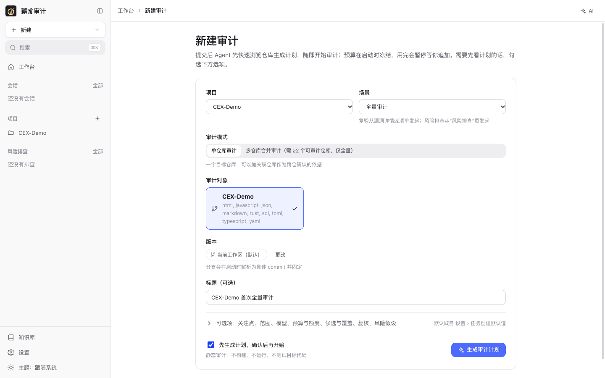

| 字段 | 说明 |
| --- | --- |
| 项目 / 场景 | 选择项目和场景（全量审计、增量审计）。 |
| 审计模式 | 单仓库审计或多仓库合并审计。 |
| 审计对象 | 要审计的仓库，卡片上显示角色和版本。 |
| 关联仓库 | 单仓模式下可选，只作为跨仓确认的证据来源。 |
| 版本 | 默认“当前工作区”；可以改为分支、标签或 commit。分支会在启动时解析为具体 commit 并固定。 |
| 标题 | 可选。 |
| 先生成计划，确认后再开始 | 勾选后，Agent 先生成计划，等你确认再开始；不勾选时提交后直接开始。 |

预算在启动时冻结，用完会暂停等你追加。

### 可选项

展开 **可选项：关注点、范围、模型、预算与额度、候选与覆盖、复核、风险假设**，默认值取自 [设置 › 任务创建默认值](10-settings.md#任务创建默认值)：

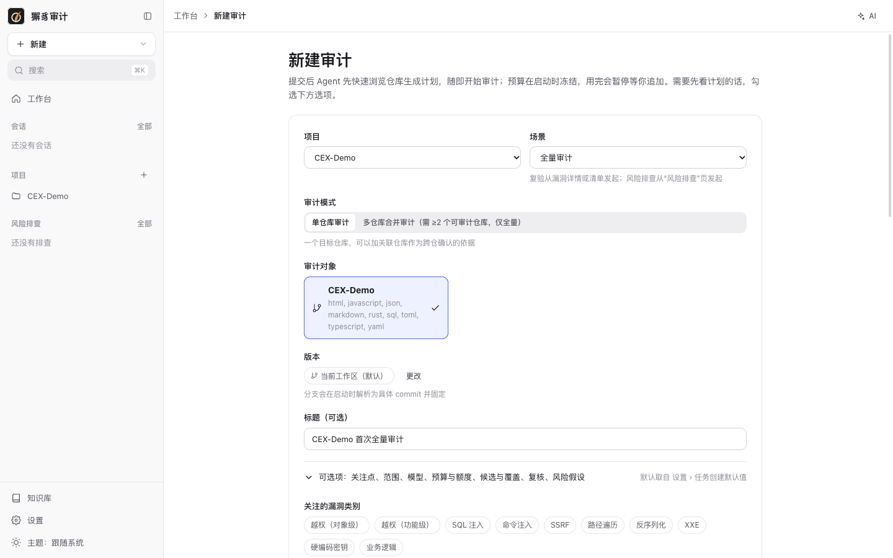

| 选项 | 说明 |
| --- | --- |
| 关注的漏洞类别 | 越权（对象级 / 功能级）、SQL 注入、命令注入、SSRF、路径遍历、反序列化、XXE、硬编码密钥、业务逻辑等。 |
| 业务关注点 | 用自然语言描述要重点看的业务风险。 |
| 只审计这些路径 / 排除路径 | 每行一个 glob，例如 `src/main/**`、`**/test/**`。 |
| 各阶段模型 | 本次审计各阶段使用的模型和思考强度，只在本次生效。 |
| 多模型交叉 | 选 2–4 个模型，勾选的环节由每个模型各做一遍。 |
| token 预算 / 时长上限 | 默认 1200 万 tokens、240 分钟。配置了价格表时会显示预计费用。 |
| 限制各阶段额度 | 开启后按百分比给各阶段分配额度，某阶段用完时暂停等待追加；关闭时各阶段只受总预算限制。 |
| 候选上限 | 追查的候选最多这么多个，其余记为覆盖缺口。 |
| 入口 / 危险点覆盖目标（%） | 覆盖目标，以及覆盖不足时的处理：只声明缺口，或补齐（再追查未覆盖的候选）。 |
| 对抗复核 | 汇总后对每个正式发现做一次独立的反向论证，降低误报。 |
| 风险假设先行 | 先按威胁模型列出仓库可能面临的风险假设（最多 500 条），再逐条用代码验证，计入覆盖对照。会增加 token 消耗和耗时；审计结束后也可以在“覆盖对照”中追加执行。 |

### 增量审计

场景选择 **增量审计 · 单仓库** 时，表单会多出 **对比基线**：默认是上次审计的版本，也可以选择任意分支或提交（例如 feature 分支对比 main）。增量审计只审计变更和受变更影响的范围，适合在合并请求或发版前使用。还可以关联[需求威胁模型](06-threat-models.md)。

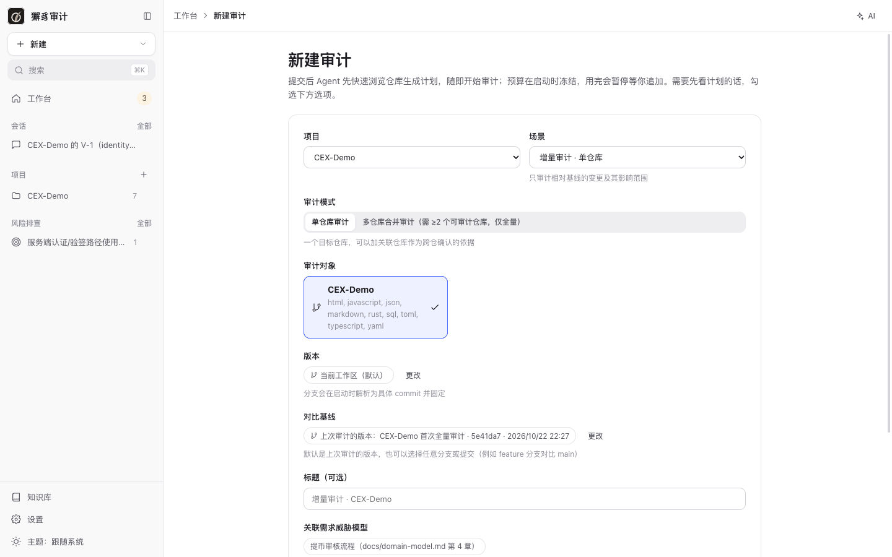

## 计划确认

勾选“先生成计划”后，Agent 会快速浏览仓库并生成审计计划：

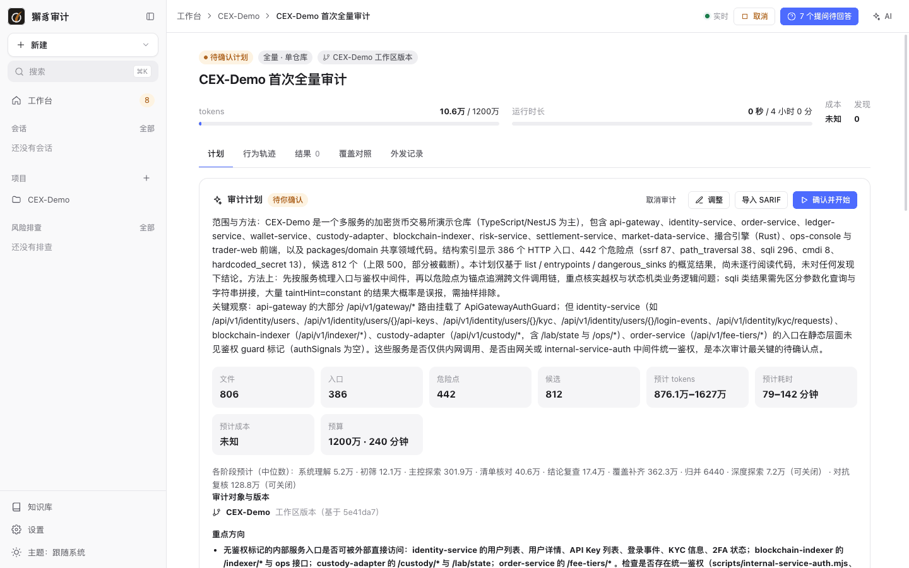

上图是 CEX-Demo 的计划：806 个文件、386 个 HTTP 入口、442 个危险点、812 个候选（超过 500 的上限，部分被截断），预计 876 万到 1627 万 tokens、79 到 142 分钟。计划包括：

- **范围与方法**：目标文件、已识别的入口、结构索引发现的危险点，以及关键观察（例如哪些内部服务的入口在静态层面没有鉴权标记）。
- **统计**：文件、入口、危险点、候选数量，预计 tokens、耗时和成本，以及各阶段的预计用量。
- **审计对象与版本**：每个仓库固定的 commit。
- **重点方向**：每条方向写明原因，例如“已鉴权不等于已做归属校验；交易所类系统中订单、充提、账本资源的越权是典型高危问题”。
- **计划加载的知识**：本次会用到的 skill 及用途。
- **待补充的上下文**：Agent 需要但代码里看不到的信息。

计划顶部的操作：**确认并开始**、**调整**（修改重点与范围）、**导入 SARIF**（导入其他工具的结果作为候选）、**取消审计**。

## 回答 Agent 提问

计划阶段和执行过程中，Agent 遇到代码里看不到的信息时会提问。页面顶部会显示“N 个提问待回答”，点击后在右侧审计会话中逐条回答：

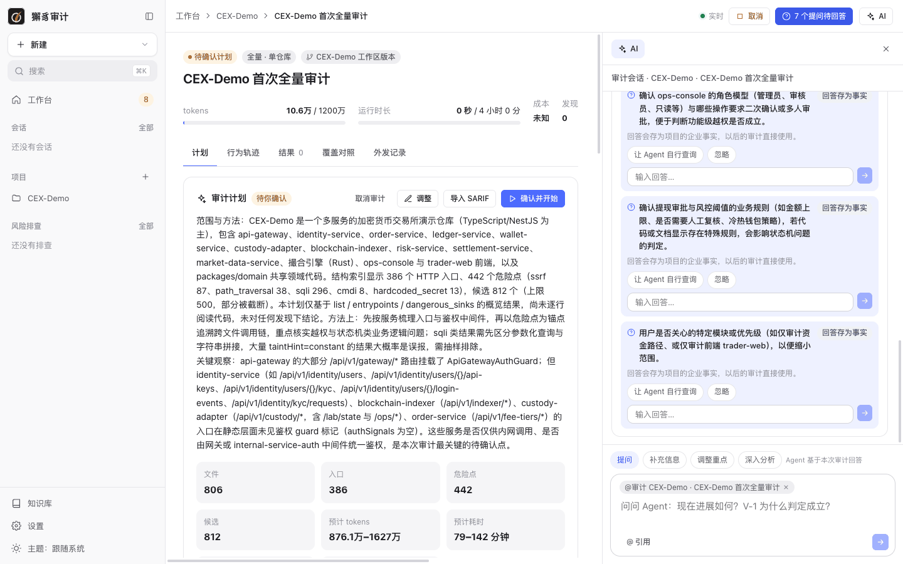

每个提问有三种处理方式：

- **直接输入回答**：标着“回答存为事实”的提问，答案会保存为项目的[企业事实](03-projects.md#企业事实)，以后的审计直接使用。
- **让 Agent 自行查询**：Agent 自己查询代码与配置后判断。
- **忽略**。

不回答也不会阻塞审计：Agent 会把相关结论标为“待确认”。在终端里运行审计时，提问可以直接在终端回答（回车跳过）。

上图的 7 个提问中，部署拓扑一条按仓库 README 回答（存为事实），审计范围一条回答“全部模块”，其余交给 Agent 自行查询。

## 执行跟踪

审计开始后，页面实时显示进度：

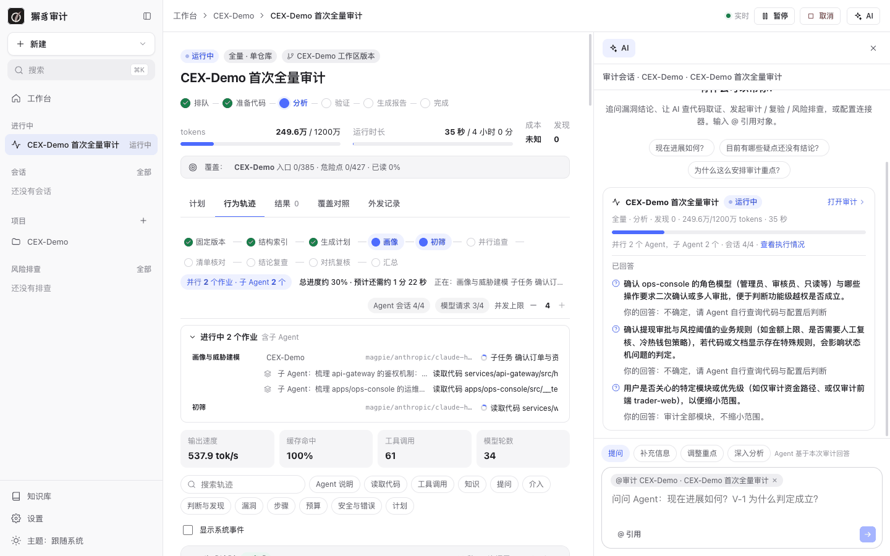

- **阶段条**：排队 → 准备代码 → 分析 → 验证 → 生成报告 → 完成。
- **用量**：tokens 用量 / 预算、运行时长 / 上限、成本、发现数。
- **覆盖条**：每个仓库的入口、危险点覆盖和已读比例。
- **步骤条**：固定版本、结构索引、生成计划、画像、初筛、并行追查、清单核对、结论复查、对抗复核、汇总。
- **并行作业**：总进度、预计剩余时间、当前正在做什么；展开可以看到每个并行作业（含子 Agent）在做什么、等什么、用哪个模型。
- **并发上限**：Agent 会话数和模型请求数，可以在运行中用 `−` / `+` 调整。
- **指标**：输出速度、缓存命中率、工具调用次数、模型轮数。
- 右上角可以 **暂停**、**取消**。

## 行为轨迹

**行为轨迹** 标签按“Agent 说明 → 工具 → 结果”叙述整个过程。可以搜索轨迹，并按类型筛选：Agent 说明、读取代码、工具调用、知识、提问、介入、判断与发现、漏洞、步骤、预算、安全与错误、计划。勾选“显示系统事件”可以看到系统级事件，也可以按仓库筛选。


每个步骤（如“生成计划”“画像与威胁建模”）是一个可折叠的分组，标题行显示耗时、调用次数和 tokens。你回答提问、介入审计的记录也会出现在轨迹中。

审计中的威胁建模会把系统划分为若干**风险领域**，每个领域由一位专家 Agent 自主探索。轨迹顶部的“领域规划”列出各领域的说明、关联的漏洞类别和完成情况，也可以 **新增领域**（审计结束后追加执行）：

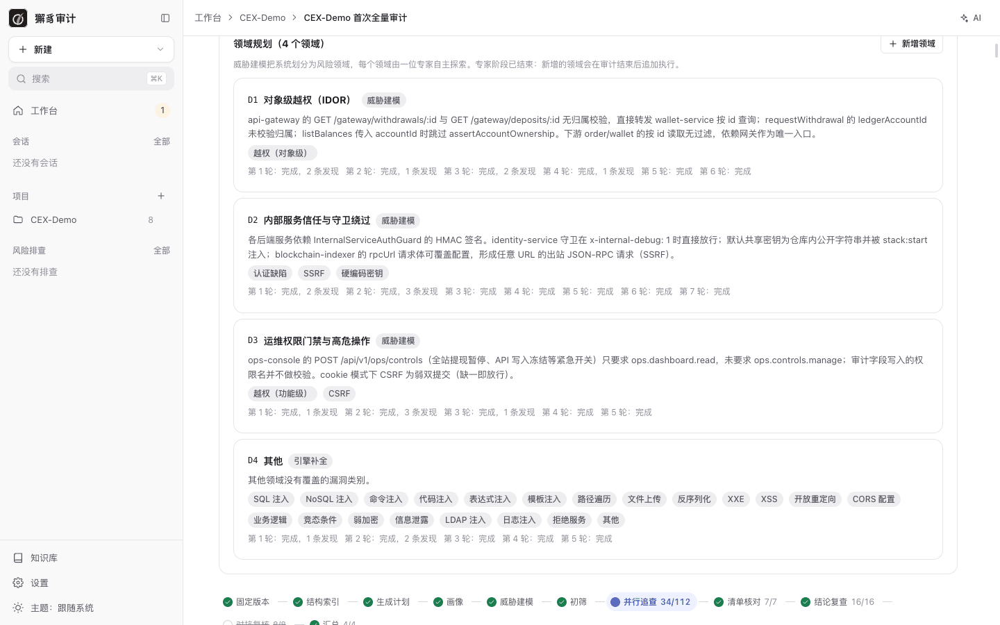

## 预算不足与追加

预算用完，或引擎预估剩余步骤放不进剩余预算时，审计会暂停，状态变为“等待预算”，页面顶部出现提示：

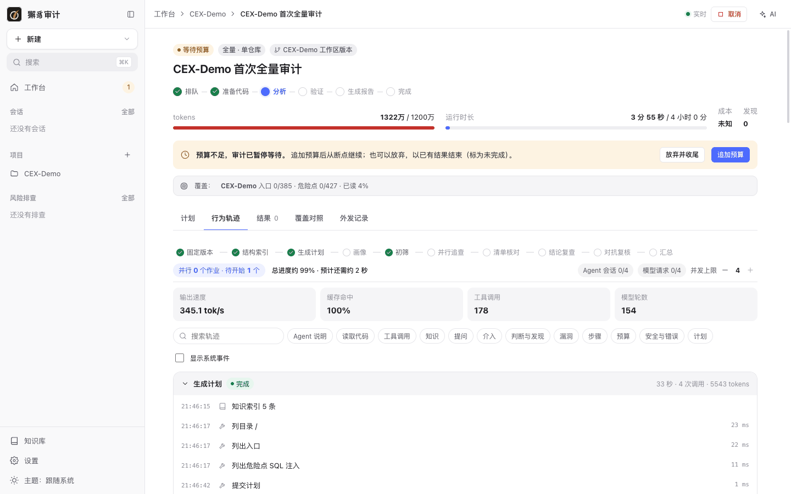

- **追加预算**：输入追加的 tokens 和时长（可选）。追加后审计从断点继续：已完成的步骤不重复，停下的会话从停下的地方接着做。
- **放弃并收尾**：以已有结果结束，审计标为未完成。

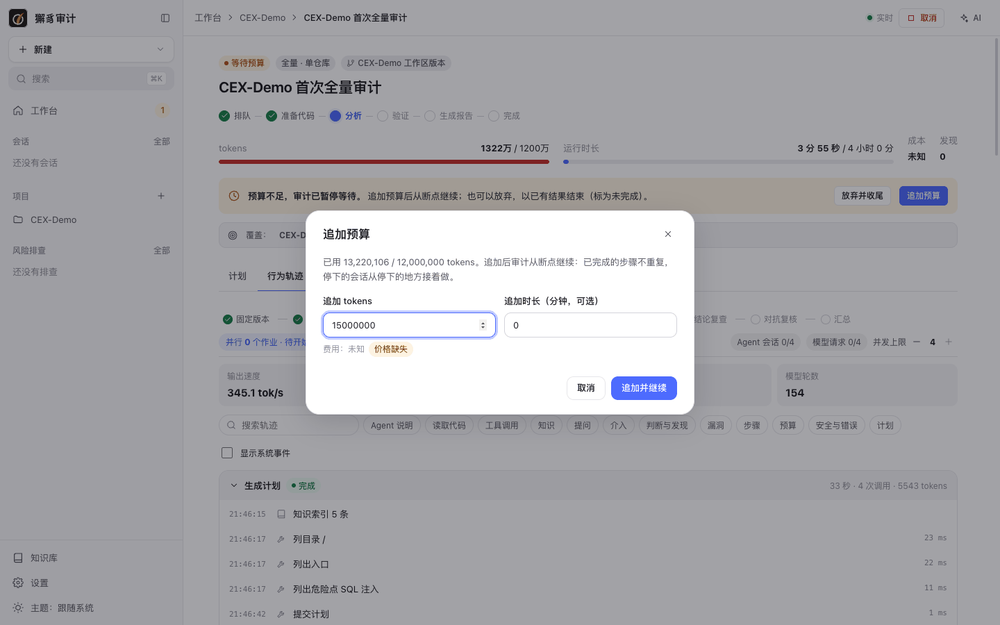

命令行：`xiezhi audit resume <auditId> --add-tokens N` 追加，`--decline-budget` 放弃并收尾（见 [命令行参考](11-cli.md)）。

在 CEX-Demo 上，默认的 1200 万预算在分析阶段就用完了，之后追加到 5200 万，“补齐覆盖”仍不断生成新的补审步骤（共 107 个），引擎又建议追加约 6700 万。这时选择了放弃并收尾。大型仓库建议先在 [任务创建默认值](10-settings.md#任务创建默认值) 中调高预算，或把覆盖不足时的处理设为“只声明缺口”，再用“覆盖对照”按需补审。

计入预算的 tokens 包含缓存命中的输入，所以总数会明显大于模型实际输出的 tokens。

如果某个步骤被模型的内容过滤拦截，页面会提供 **原样重试**、**切换模型重试** 和 **从头开始这些步骤** 等选项。

## 结果

审计结束后进入 **结果** 标签。下图是放弃追加、以已有结果收尾的审计，状态为“未完成”，未完成原因为“预算耗尽”和“覆盖未达标”：

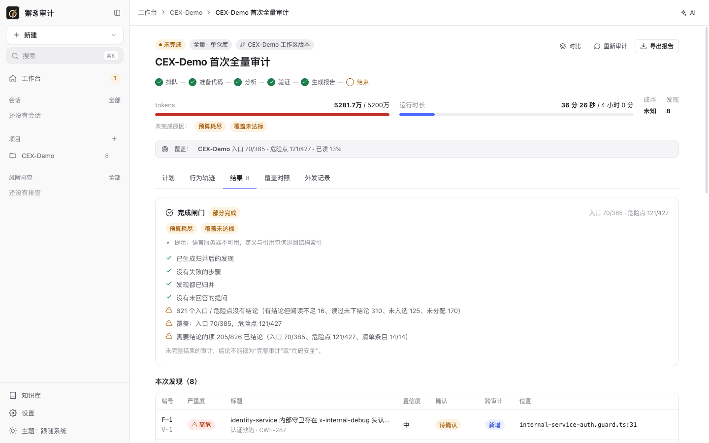

- **完成闸门**：逐项检查审计是否完整：已生成归并后的发现、没有失败的步骤、发现都已归并、没有未回答的提问、入口与危险点都有结论、覆盖达到目标、需要结论的项都已结论。没通过的项会列出原因，例如“621 个入口 / 危险点没有结论（读过未下结论 310、未入选 125、未分配 170……）”。未完整结束的审计，结论不能视为“完整审计”或“代码安全”。
- **本次发现**：编号（F-本次编号 / V-项目漏洞编号）、严重度、标题与类别、置信度、确认状态、跨审计状态、位置。点击行打开[漏洞详情](05-vulns.md#漏洞详情)。
- **证据不足**：单独列出，不计入正式结论。
- **用量**：各环节的次数、输入 / 输出 tokens、成本。未配置价格时成本记为“未知”，可以在 [设置 › 通用 › 价格表](10-settings.md#通用) 中配置。
- **本次用到的知识**：每个 skill 的加载方式、次数、tokens，以及被结论引用的比例。

审计页右上角：**对比**、**重新审计**、**导出报告**。

## 覆盖对照

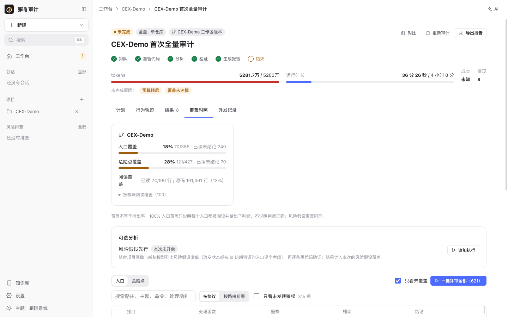

- 每个仓库的**入口覆盖**、**危险点覆盖**、**阅读覆盖**（已读行数 / 源码行数），可以展开查看按模块的阅读覆盖。
- 覆盖不等于检出率：100% 入口覆盖只说明每个入口都被阅读并给出了判断，不说明判断正确。
- **可选分析**：本次没有开启“风险假设先行”时，可以点 **追加执行**。
- 下方列出入口和危险点清单，勾选“只看未覆盖”可以只看缺口，点 **一键补审全部** 追查所有未覆盖项。审计因预算收尾后，可以在这里按需补审。

## 外发记录

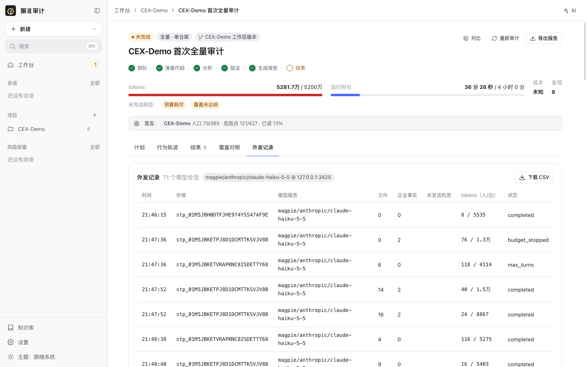

列出本次审计向外部发送的每一次模型调用：时间、步骤、模型服务、发送的文件数、引用的企业事实数、未发送的机密、tokens（入 / 出）和状态。点 **下载 CSV** 可以导出，用于合规审计。

## 审计对比

点 **对比**，选择一次较早的审计。下图是复验之后与首次全量审计的对比：

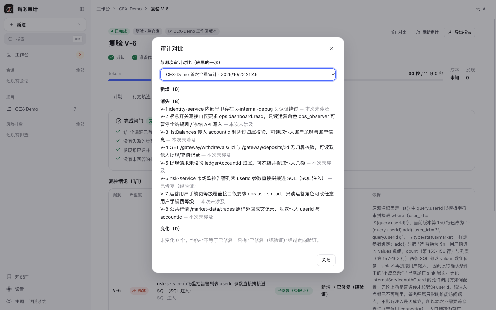

对比结果分为**新增**、**消失**、**变化**和未变化数量。注意：“消失”不等于已修复，只有“已修复（经验证）”经过定向验证。上图中，复验只涉及 V-6，所以其余 7 个漏洞都显示为“消失 — 本次未涉及”，只有 V-6 显示为“已修复（经验证）”。

## 导出报告

点 **导出报告**：

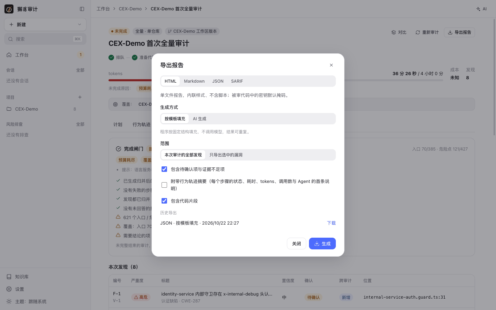

| 选项 | 说明 |
| --- | --- |
| 格式 | HTML、Markdown、JSON、SARIF。 |
| 生成方式 | **按模板填充**：程序按固定结构填充，不调用模型，结果可重复。**AI 生成**：报告模型按所选报告 skill 写整份报告，程序核对每条结论的编号、严重度和确认状态，不一致时让模型修正一次。 |
| 范围 | 本次审计的全部发现，或只导出选中的漏洞。 |
| 包含待确认项与证据不足项 | 默认勾选。 |
| 附带行为轨迹摘要 | 每个步骤的状态、耗时、tokens、调用数。 |
| 包含代码片段 | AI 生成模式下表示“把代码片段交给报告模型”。 |
| 报告 skill | 选择报告模板；不选时用设置中的默认值。 |
| 写入本机绝对路径 | 仅 SARIF：便于本机 IDE 直接定位；分享给同事时取消。 |

导出的 HTML 报告：

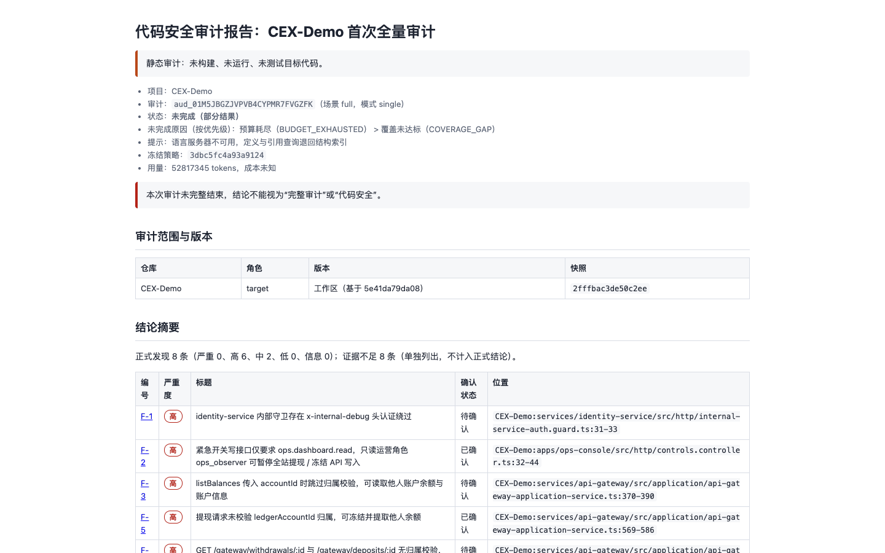

命令行导出：

```bash
xiezhi export <auditId> --format html --out report.html
```

```bash
xiezhi export <auditId> --format sarif --out report.sarif --no-local-roots
```

下一步：[5. 漏洞管理](05-vulns.md)
