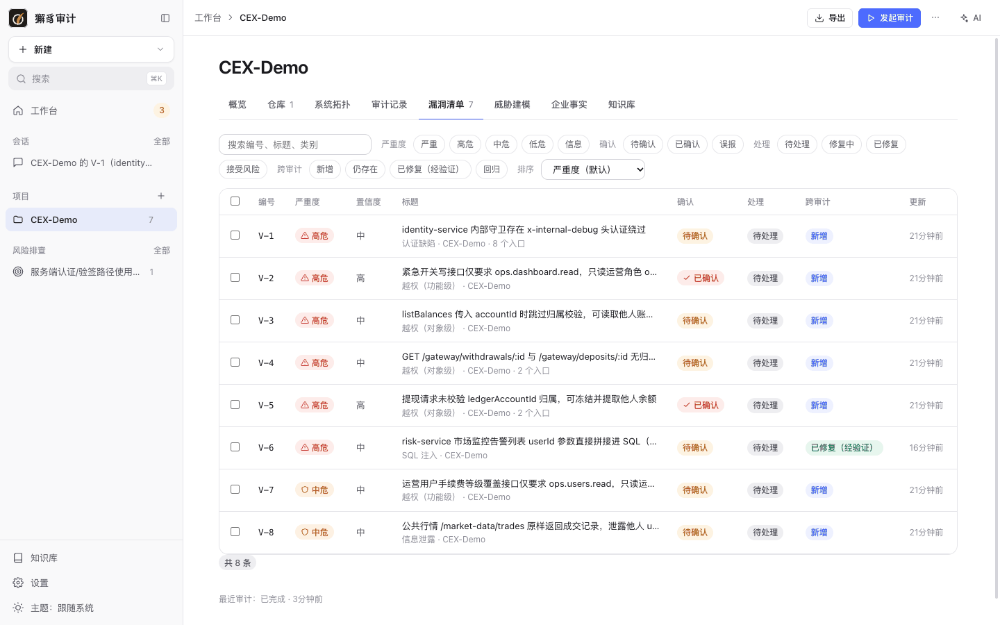
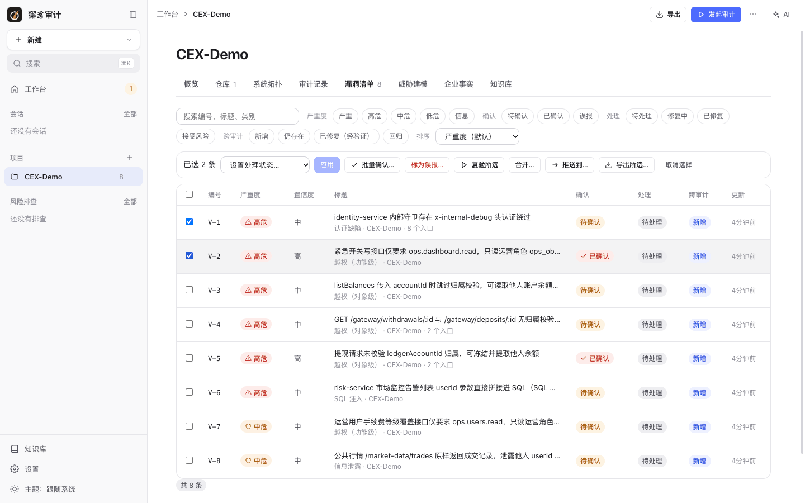
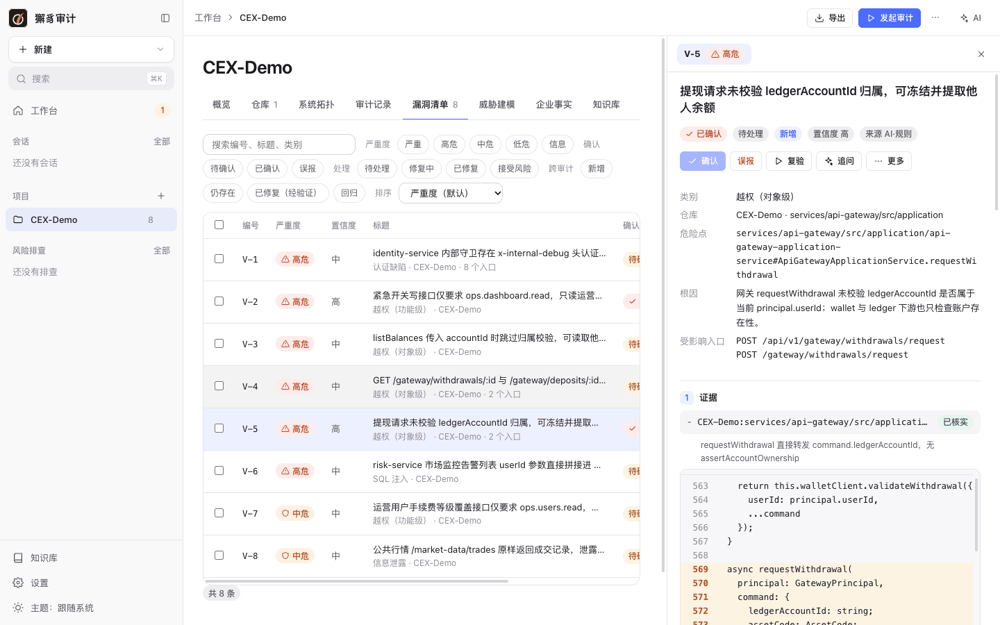
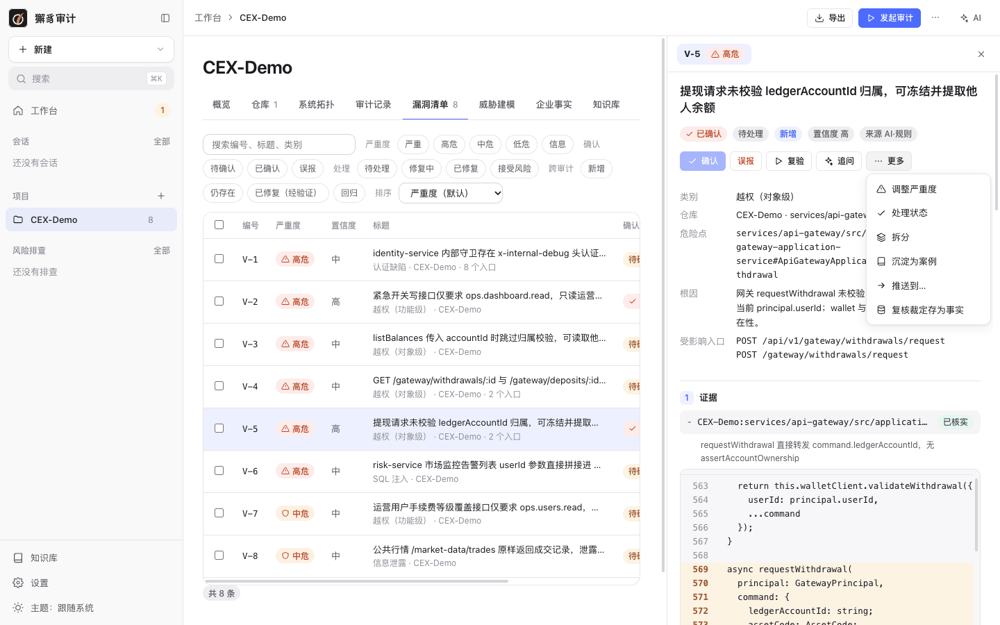
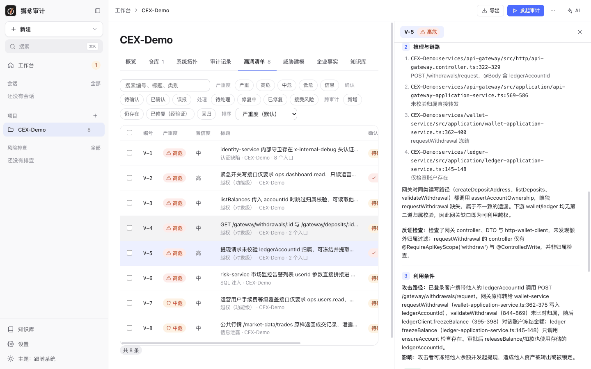
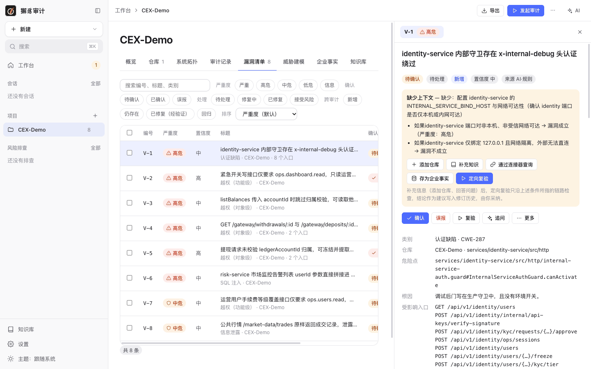
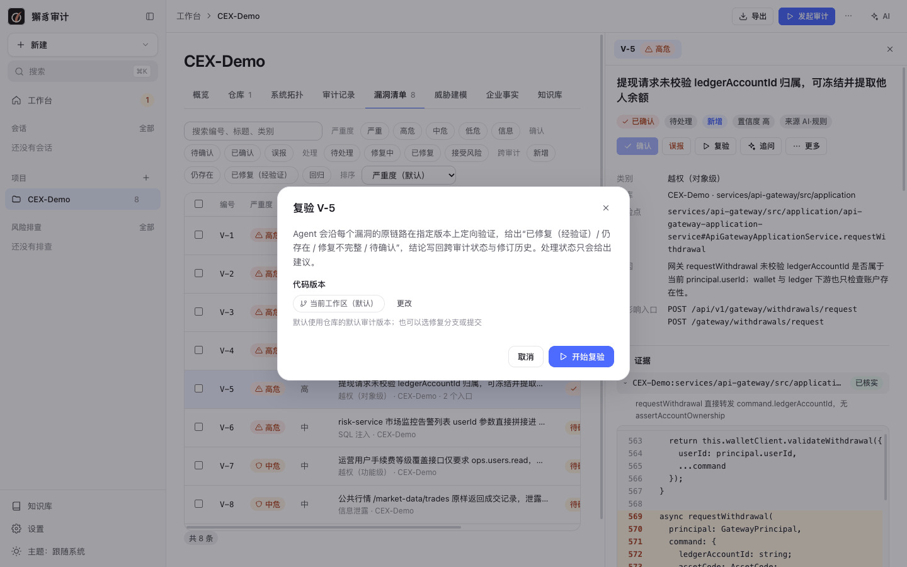
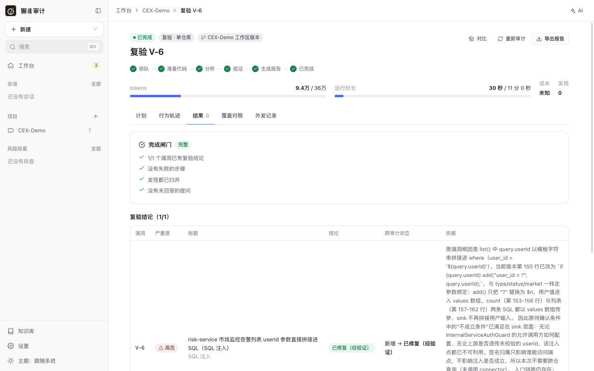
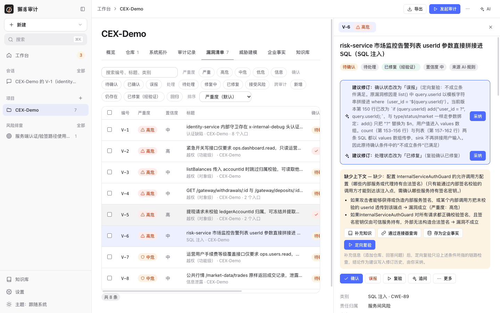
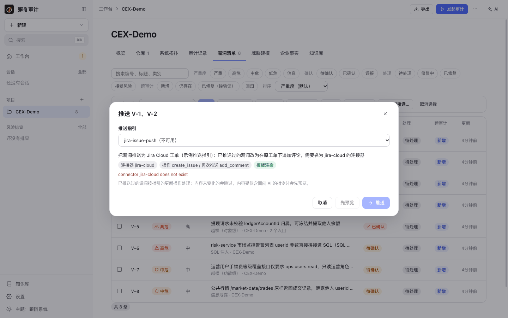

# 5. 漏洞管理

[← 返回目录](README.md)

审计中的发现归并后进入项目的**漏洞清单**，用 `V-编号` 标识，并跨审计跟踪状态。

## 漏洞状态

| 维度 | 取值 | 说明 |
| --- | --- | --- |
| 严重度 | 严重 / 高危 / 中危 / 低危 / 信息 | 可以手动调整。 |
| 置信度 | 高 / 中 / 低 | Agent 的把握程度，对抗复核会上调或下调。 |
| 确认 | 待确认 / 已确认 / 误报 | “待确认”表示成立依赖代码中看不到的条件（例如部署是否暴露端口）。 |
| 处理 | 待处理 / 修复中 / 已修复 / 接受风险 | 由你维护；复验只给出建议。 |
| 跨审计 | 新增 / 仍存在 / 已修复（经验证） / 回归 | 由后续审计和复验自动更新。 |

## 漏洞清单

项目页 **漏洞清单** 标签：

- **搜索**：编号、标题、类别。
- **筛选**：严重度、确认、处理、跨审计状态，可以多选组合。筛选条件保存在地址栏中，刷新或分享链接后保持不变。
- **排序**：严重度（默认）、置信度从高到低 / 从低到高、编号、最近更新。
- 每行显示类别、所在仓库和受影响入口数。

### 批量操作

勾选多条漏洞后，清单上方出现批量操作栏：

| 操作 | 说明 |
| --- | --- |
| 设置处理状态 → 应用 | 批量修改处理状态。 |
| 批量确认… | 批量标为已确认，可以填写整批共用的原因。 |
| 标为误报… | 批量标为误报，必须填写原因，便于日后追溯。 |
| 复验所选 | 对所选漏洞发起一次复验；一次复验只能针对一个仓库的漏洞。 |
| 合并… | 至少两条：把根因相同的漏洞合并为一条。 |
| 推送到… | 一次最多 50 条，推送到外部系统。 |
| 导出所选… | 只导出选中的漏洞。 |

## 漏洞详情

点击清单或审计结果中的任一行，右侧打开漏洞详情。下图是 CEX-Demo 的 V-5：提现请求没有校验 `ledgerAccountId` 的归属，可以冻结并提走他人余额：

**头部**：编号、严重度、标题，以及确认、处理、跨审计状态、置信度和来源（AI、规则、人工）。

**操作按钮**：

| 按钮 | 作用 |
| --- | --- |
| 确认 / 误报 | 修改确认状态，误报需要填写原因。 |
| 复验 | 在指定版本上定向验证，见下文。 |
| 追问 | 在右侧 AI 面板里继续调查这个漏洞（基于审计时的代码）。 |
| 更多 | 调整严重度、处理状态、拆分、沉淀为案例、推送到…、复核裁定存为事实。 |

- **拆分**：把一条漏洞拆为多条（例如一个漏洞实际包含两个独立根因）。
- **沉淀为案例**：AI 按案例模板把漏洞整理成项目案例库的知识草稿，审核后启用，后续审计会参考。
- **复核裁定存为事实**：把复核中确认的企业环境事实存入项目的[企业事实](03-projects.md#企业事实)。

**基本信息**：类别、仓库、危险点、根因、受影响入口。

### 证据

每条证据有代码位置、核实状态和说明，展开可以查看审计快照中的代码，危险行会高亮。

### 推理与链路

- **链路**：从入口到危险点的每一跳，可以跨服务、跨仓库。上图中，链路从 api-gateway 的 `POST /withdrawals/request` 进入，经 `requestWithdrawal`（没有 `assertAccountOwnership`）到 wallet-service 的冻结，再到 ledger-service 按 accountId 冻结余额，每一跳都标出了文件和行号。
- **推理**：Agent 的判断过程，会引用企业事实。
- **利用条件**：攻击路径和影响，例如“已登录用户携带他人的 ledgerAccountId 调用提现接口”。
- **反证检查**：Agent 主动找过的防护代码和反例。
- **对抗复核**：独立的反方论证，结论为“维持”“转为待确认”或“反驳（转为待确认，由人裁决）”，并给出置信度调整。审计因预算放弃追加、提前收尾时，这一步不会执行，详情里也就没有复核结论。

### 待确认的漏洞

确认状态为“待确认”的漏洞，会在详情顶部列出缺少的上下文、成立条件和不成立条件。下图是 V-1（identity-service 内部守卫的 `x-internal-debug` 头绕过）：漏洞是否成立，取决于 identity-service 的端口是否只在本机可达。

你可以：

- **补充信息**：回答问题、添加仓库（例如缺失的网关代码）。
- **补充知识**、**通过连接器查询**（例如查询工单或文档中的部署信息）。
- **定向复验**：只沿待确认条件所指的链路检查，结论作为建议写入修订历史。

## 复验

修复代码后，在漏洞详情点 **复验**，或在清单中勾选后点 **复验所选**，也可以在首页点 **复验已修复**：

Agent 会沿每个漏洞的原链路在指定版本上定向验证，给出“已修复（经验证）/ 仍存在 / 修复不完整 / 待确认”。结论写回跨审计状态和修订历史。处理状态只会给出建议，不会自动修改。代码版本默认用仓库的默认审计版本，也可以选修复分支或提交。

复验本身也是一次审计（场景为“漏洞复验”），有自己的结果页：

上图中，演示副本已把 risk-service 监控告警列表的 `userId` 过滤改为参数化查询，复验花了约 9 万 tokens、30 秒，结论为“已修复（经验证）”，跨审计状态从“新增”变为“已修复（经验证）”。依据里写明了修复所在的行、参数绑定的方式，以及为什么数组形式的参数也不再构成注入。

### 建议修订

复验或复核产生的状态建议不会直接生效，而是在漏洞详情顶部显示为**建议修订**，同时出现在首页“待我处理”中。点 **采纳** 后生效：

所有状态变化都会记入漏洞的修订历史。一次复验可能产生多条建议。上图中，同一次复验同时建议“处理状态改为已修复”和“确认状态改为误报”。这个漏洞是真实存在、后来被修复的，所以只应采纳“已修复”这一条。采纳前请逐条核对。

## 推送到外部系统

**推送到…** 按知识库中的**推送指引**，通过连接器把漏洞写入工单等外部系统：

- 选择推送指引（内置示例：`jira-issue-push`、`meegle-defect-push`），对话框会显示它用到的连接器和操作，例如首次推送 `create_issue`、再次推送 `add_comment`。
- 需要先在 [设置 › 连接器](10-settings.md#连接器) 安装对应的连接器。上图中还没有安装名为 `jira-cloud` 的连接器，所以指引显示“不可用”。
- 已推送过的漏洞按指引的更新操作处理，内容没有变化的会跳过。
- 内容疑似包含面向 AI 的指令时，会先进入预览。也可以手动点 **先预览**。
- 推送后，漏洞详情会显示外部记录链接；也可以手动“关联已有外部记录”。

下一步：[6. 需求威胁建模](06-threat-models.md)
