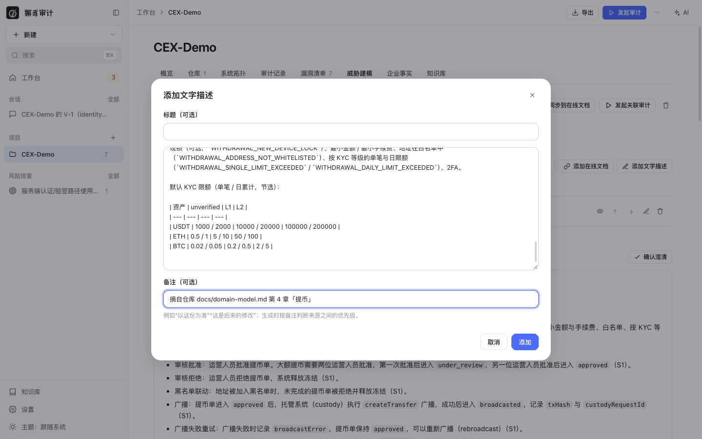
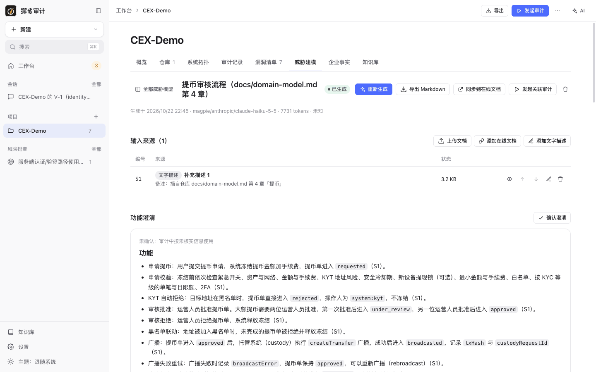
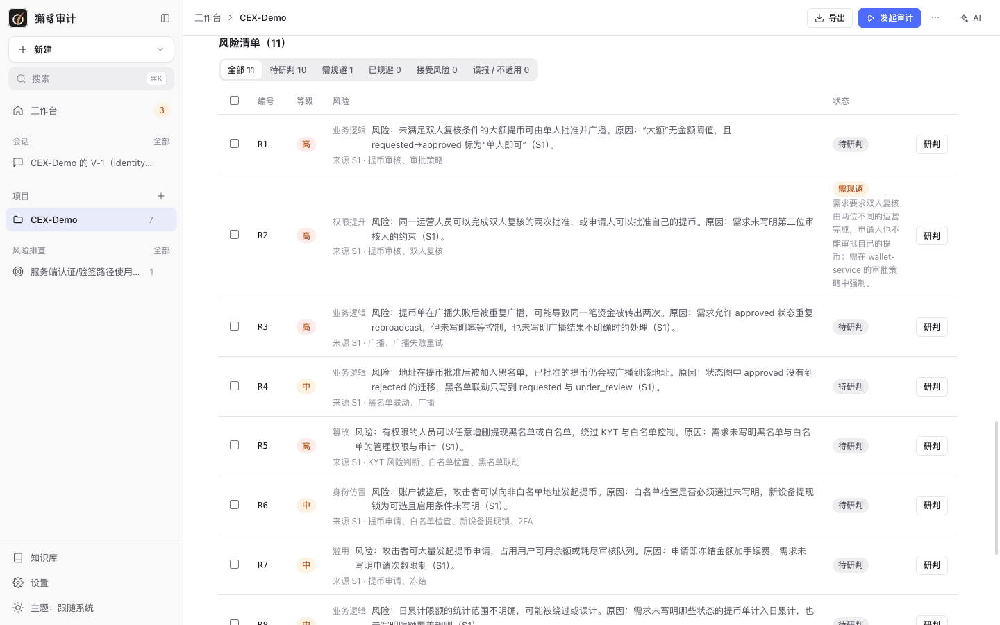
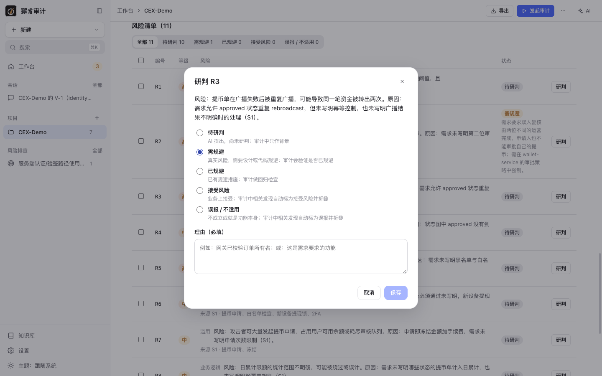
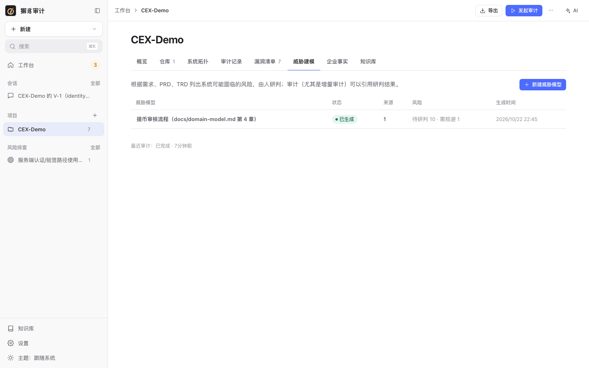

# 6. 需求威胁建模

[← 返回目录](README.md)

需求威胁建模根据需求文档、PRD、TRD 列出系统可能面临的风险，由人研判。研判结果可以作为审计（尤其是增量审计）的风险假设输入：需要规避的风险会被验证，已接受或误报的风险会让相关发现自动折叠。

## 新建威胁模型

进入项目页 **威胁建模** 标签，点 **新建威胁模型**，填写标题（例如需求名称或迭代名称），点 **创建**。

## 添加来源

威胁模型可以有多个输入来源：

| 来源 | 说明 |
| --- | --- |
| 上传文档 | 上传本地需求文档。 |
| 添加在线文档 | 填写文档链接或 ID，通过连接器读取（例如飞书文档）。需要先在 [设置 › 连接器](10-settings.md#连接器) 配置可用的连接器，生成时按知识库中的读取指引调用它。 |
| 添加文字描述 | 直接粘贴需求说明、业务规则或后来的修改。 |



每个来源可以写**备注**，例如“以这份为准”“这是后来的修改”，生成时按备注判断来源之间的优先级。来源可以上移、下移、编辑和删除。来源内容中有疑似注入指令时会提示，确认后才会使用。

## 生成

添加来源后点 **生成**。AI 会生成**功能澄清**和**风险清单**。下图以 CEX-Demo 仓库自带的设计文档 `docs/domain-model.md` 第 4 章（提币状态机与审核规则）为输入，生成了 11 条风险：



页面顶部的操作：

- **重新生成**：来源在上次生成后有变化时会提示重新生成，已研判的风险会保留状态。
- **导出 Markdown**。
- **同步到在线文档**：按推送指引把威胁模型写回在线文档。
- **发起关联审计**：直接进入增量审计表单，并关联这个威胁模型。
- 删除威胁模型。

### 功能澄清

列出功能、角色与权限、数据与资产、信任边界、设计如此的行为、待确认与冲突点，每条都标注来源（如 `S1`）。核对无误后点 **确认澄清**。

## 研判风险清单



每条风险有编号、等级（高 / 中 / 低）、类别（权限提升、信息泄露、抵赖、业务逻辑、滥用、身份伪冒等）和来源。按状态筛选，逐条点 **研判**，或勾选多条后 **批量研判**：



例如 R2“同一运营人员可以完成双人复核的两次批准”，研判为“需规避”，理由写明“双人复核必须由两位不同的运营完成”。之后关联这个威胁模型的审计会专门验证代码是否做到了这一点。需求层面的风险清单能覆盖代码审计不容易发现的业务规则缺陷。

| 状态 | 含义 | 对审计的影响 |
| --- | --- | --- |
| 待研判 | AI 提出，尚未研判 | 审计中只作背景 |
| 需规避 | 真实风险，需要设计或代码规避 | 审计会验证是否已规避 |
| 已规避 | 已有规避措施 | 审计做回归检查 |
| 接受风险 | 业务上接受 | 审计中相关发现自动标为接受风险并折叠 |
| 误报 / 不适用 | 不成立或就是功能本身 | 审计中相关发现自动标为误报并折叠 |

除“待研判”以外，研判必须填写理由，例如“网关已校验订单所有者”或“这是需求要求的功能”。每条风险都保留研判历史。

## 威胁模型列表



列表显示每个威胁模型的状态（草稿、生成中、已生成、结果不完整、生成失败）、来源数、各状态的风险数和生成时间。

## 关联到审计

- 在威胁模型页面点 **发起关联审计**。
- 或在新建增量审计时选择要关联的威胁模型。
- 命令行：`xiezhi audit start --project <p> --threat-model <id>`（可重复，全量或增量审计都支持）。

命令行只读查看与导出：

```bash
xiezhi threat-model list --project CEX-Demo
```

```bash
xiezhi threat-model export <id> --out threat-model.md
```

下一步：[7. 风险排查](07-risk-hunts.md)
