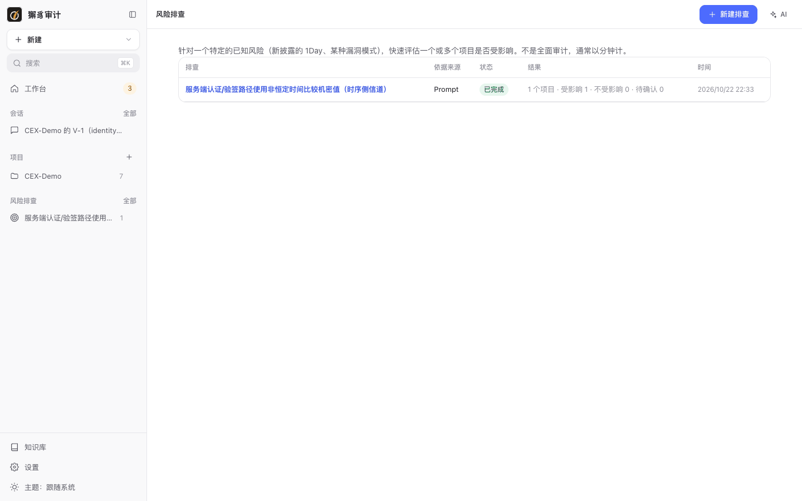
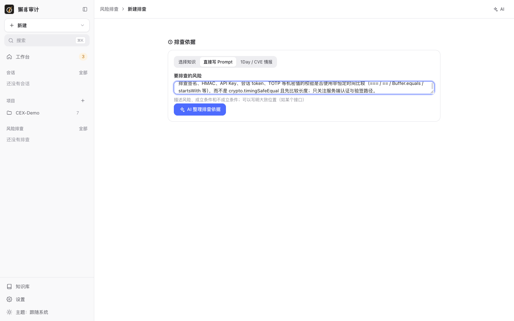
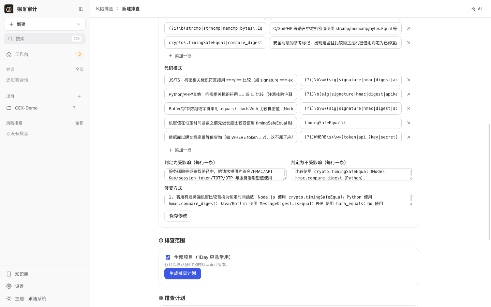
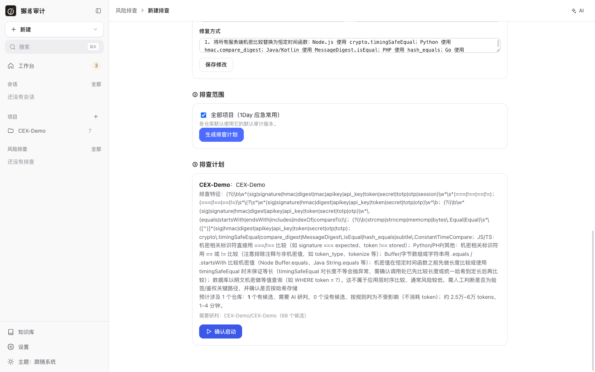
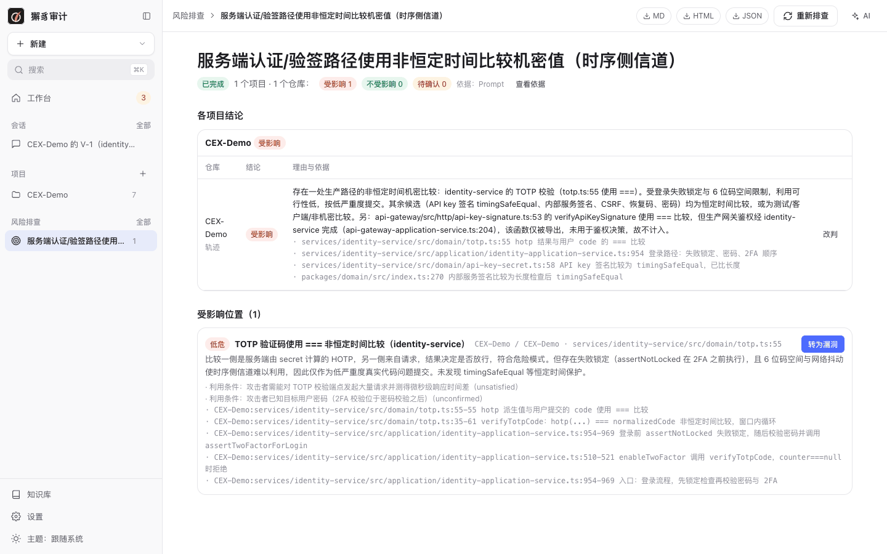

# 7. 风险排查

[← 返回目录](README.md)

风险排查针对一个特定的已知风险（新披露的 1Day、某种漏洞模式），快速评估一个或多个项目是否受影响。它不是全面审计，通常几分钟就能完成。

## 排查列表

侧栏 **风险排查 › 全部**，或首页的 **风险排查** 按钮：



列表显示每次排查的标题、依据来源、状态、结论汇总（受影响 / 不受影响 / 待确认）和时间。

## 新建排查

点 **新建排查**，流程分三步：

### ① 排查依据

依据有三种来源：

| 来源 | 说明 |
| --- | --- |
| 选择知识 | 从知识库中选择一个漏洞案例或审计方法 skill。 |
| 直接写 Prompt | 描述风险、成立条件和不成立条件，可以写明大致位置（如某个接口）。 |
| 1Day / CVE 情报 | 粘贴漏洞公告正文或 CVE 编号，例如“CVE-2022-42889 Apache Commons Text 1.5–1.9 StringSubstitutor 插值导致远程代码执行…”。粘贴公告正文效果最好。 |



点 **AI 整理排查依据**。AI 会把描述整理成结构化的依据，请核对并按需修改：



| 字段 | 说明 |
| --- | --- |
| 标题 / 风险说明 | 排查的对象和风险。 |
| 受影响组件 | 每行“生态 名称 版本范围”。生态为 maven / go / npm / pypi / composer / nuget / rubygems / cargo / any；maven 名称写 `groupId:artifactId`，composer 写 `vendor/package`；范围如 `<2.13.4.2` 或 `*`。 |
| 危险 API | 正则表达式 + 说明，用于快速定位候选位置。 |
| 代码模式 | 无法用正则可靠判断的模式描述，可以附带 grep 表达式。 |
| 判定为受影响 / 不受影响 | 每行一条判定条件。 |
| 修复方式 | 给出修复建议。 |

修改后点 **保存修改**。整理好的依据可以 **存为 skill**，生成知识草稿，以后直接选用。

### ② 排查范围

选择要排查的项目，或勾选 **全部项目**（1Day 应急常用）。各仓库默认使用它的默认审计版本。

### ③ 排查计划

点 **生成排查计划**。系统先用依据中的特征做确定性预检：



- 没有任何候选的仓库直接按规则判为“不受影响”，不消耗 token。
- 有候选的仓库需要 AI 研判，计划会给出预计 tokens 和耗时。

点 **确认启动**。每个项目会生成一条“风险排查”审计。排查也受预算约束：CEX-Demo 上 68 个候选的排查在默认预算下暂停了一次，追加后实际用了约 58 万 tokens。

## 排查结果



- **汇总**：项目数、仓库数，以及受影响、不受影响、待确认、未完成的数量。
- **各项目结论**：每个仓库的结论、理由和依据，可以查看轨迹。依据包括“未搜索到某特征”这类否定证据。
- **改判**：不同意 AI 的结论时点 **改判**，必须填写理由，结果标为“人工改判”。
- **受影响位置**：每个命中点的严重度、位置、成立理由、利用条件（已确认 / 未确认）和代码证据。点 **转为漏洞** 加入项目漏洞清单。
- 右上角可以导出 **MD**、**HTML**、**JSON**，或 **重新排查**（例如修复后再查一次，结果会与上一次对比）。

上图是在 CEX-Demo 上排查“机密值的非恒定时间比较”的结果。预检找到 68 个候选，AI 逐个研判：identity-service 的 TOTP 校验（`totp.ts:55`）用 `===` 比较，判为受影响（低危）；API Key 验签、内部服务签名、CSRF、恢复码、密码都使用恒定时间比较，或者只出现在测试和客户端代码中，判为不受影响。api-gateway 中有一个用 `===` 比较签名的导出函数，排查核实它只在测试中使用，生产鉴权走 identity-service，所以没有计入。

## 命令行

```bash
xiezhi hunt basis --prompt "排查签名、HMAC、API Key、TOTP 等机密值是否使用非恒定时间比较"
```

```bash
xiezhi hunt start --basis <basisId> --all --yes --wait
```

```bash
xiezhi hunt show <huntId>
```

```bash
xiezhi hunt promote <hitId>
```

```bash
xiezhi hunt export <huntId> --format md --out hunt.md
```

```bash
xiezhi hunt save-skill <basisId> --category vuln_case
```

`--prompt`、`--intel` 可以写 `@文件` 从文件读取；也可以用 `--skill <name>` 从知识库选择依据。

下一步：[8. AI 会话](08-conversations.md)
