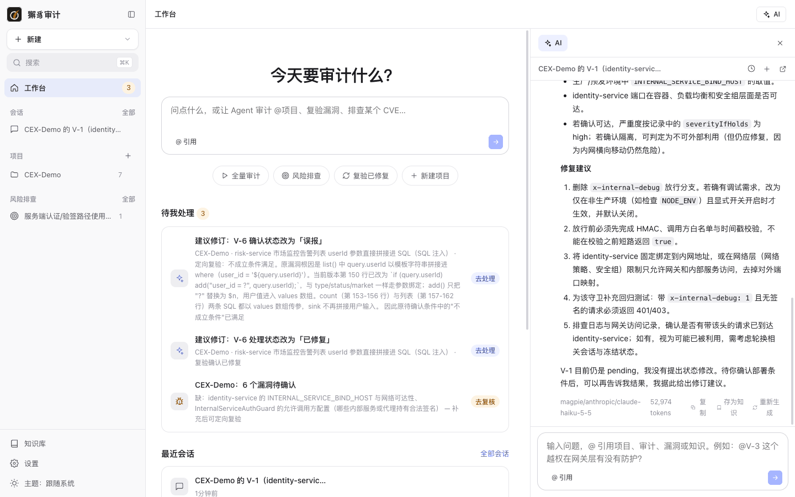
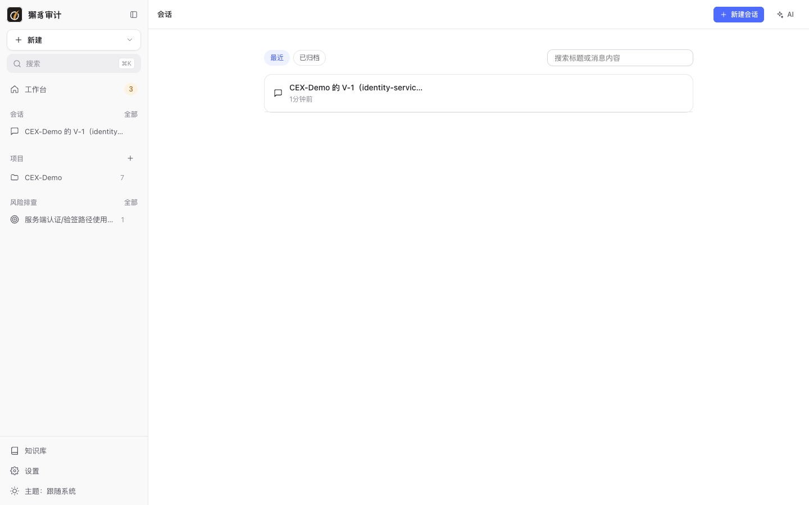

# 8. AI 会话

[← 返回目录](README.md)

AI 会话让你用自然语言和 Agent 协作：追问漏洞结论、让 AI 查代码取证、发起审计 / 复验 / 风险排查，或配置连接器。

## 开始会话

有三个入口：

- 首页输入框：输入问题后回车，在右侧 AI 面板中开始一个新会话。
- 任意页面右上角的 **AI** 按钮（`⌘J`）。
- **会话** 页面的 **新建会话**。

输入 `@` 可以引用项目、仓库、审计、漏洞或知识，例如“@V-3 listBalances 的越权在网关层有没有防护？”。

## 会话中的 Agent

Agent 会调用只读工具查询项目、漏洞、审计结论和代码，每次工具调用都以可展开的条目显示（如“列出项目”“查看漏洞 V-1”）。回答使用 Markdown 渲染。

每条回答下方显示所用模型和 tokens，并提供：

- **复制**
- **存为知识**：把回答整理成知识草稿。
- **重新生成**

回答进行中可以点 **停止**。

### 会话卡片

需要改变数据的操作不会由 AI 直接执行，而是以**卡片**形式给出，由你点击应用：

| 卡片 | 说明 |
| --- | --- |
| 调查结果 | 对某个问题的调查结论与依据。 |
| 修订建议 | 建议修改漏洞的确认状态、严重度、处理状态，或合并 / 拆分漏洞。卡片带着生成时的漏洞版本，漏洞已被别人修改时会拒绝应用。 |
| 审计 / 复验 / 排查计划 | 确认后发起对应任务。 |
| 审计实时状态 | 会话中发起的审计，在卡片中实时显示进度。 |
| 连接器草稿 | 让 AI 帮你配置连接器时生成的草稿。 |

## 审计会话

在审计页面打开 AI 面板时，进入的是这次审计专属的会话，输入框上方有四种模式：

| 模式 | 作用 | 示例 |
| --- | --- | --- |
| 提问 | 询问进展和判断依据（只读，基于审计快照） | “现在进展如何？V-1 为什么判定成立？” |
| 补充信息 | 补充业务或部署信息 | “网关已对 /admin/** 统一鉴权” |
| 调整重点 | 改变运行中审计的关注点 | “先别看日志模块，优先支付回调” |
| 深入分析 | 让 Agent 深挖某处 | “深入分析 /order/export 的归属校验” |

后三种以“介入”的形式发送给正在运行的审计，回执显示在会话末尾的实时卡片上，也会记入[行为轨迹](04-audits.md#行为轨迹)。Agent 的提问也在审计会话中回答（见 [回答 Agent 提问](04-audits.md#回答-agent-提问)）。

## 会话列表

侧栏 **会话 › 全部**：

- **最近** / **已归档** 两个分组。
- 可以按标题或消息内容搜索。
- 在侧栏会话上悬停可以重命名、归档、删除。

下一步：[9. 知识库](09-knowledge.md)
