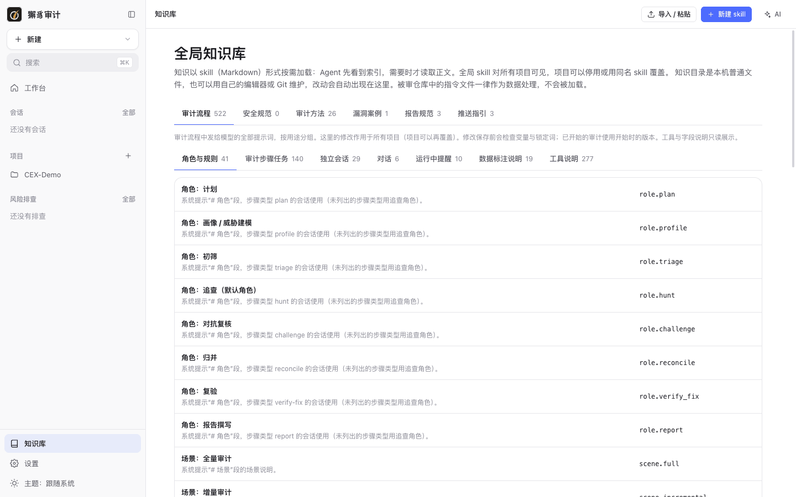
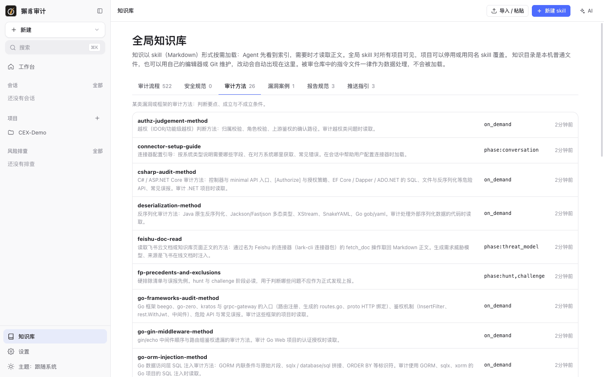
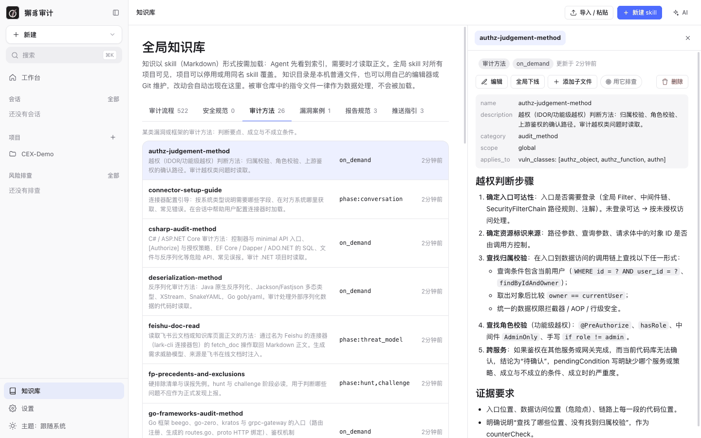
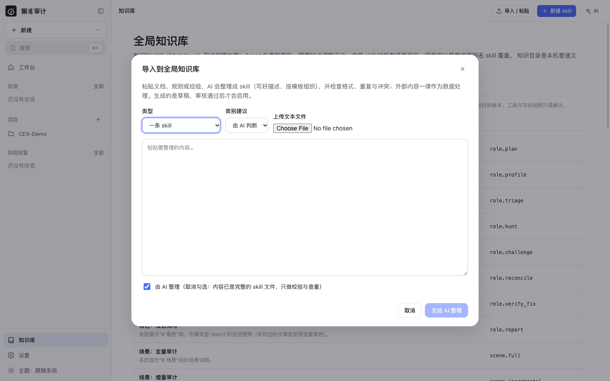

# 9. 知识库

[← 返回目录](README.md)

知识以 **skill**（Markdown 文件）的形式按需加载：Agent 先看到索引，需要时才读取正文。全局 skill 对所有项目可见，项目可以停用某个 skill，或用同名 skill 覆盖它。

知识目录是本机的普通文件，也可以用自己的编辑器或 Git 维护，改动会自动出现在界面中。被审仓库中的指令文件一律作为数据处理，不会被加载。

## 全局知识库

侧栏 **知识库**：



知识按类别分标签页：

| 类别 | 内容 |
| --- | --- |
| 审计流程 | 审计流程中发给模型的全部提示词，按用途分组：角色与规则、审计步骤任务、独立会话、对话、运行中提醒、数据标注说明、工具说明。 |
| 安全规范 | 团队自己的安全编码规范。 |
| 审计方法 | 某类漏洞或框架的审计方法：判断要点、成立与不成立条件。内置 Java / Go / Python / JavaScript / PHP / Kotlin / C# / Ruby / Rust 等语言和常见框架的方法，以及越权判断、反序列化、SSRF、误报先例等。 |
| 漏洞案例 | 案例库：真实漏洞的成立条件、修复方式，供审计和风险排查参考。 |
| 报告规范 | 报告模板，例如默认报告布局、威胁模型报告模板。 |
| 推送指引 | 把漏洞或威胁模型推送到外部系统（Jira、Meegle、飞书文档等）的步骤。 |

项目知识库中还有**系统架构**和**业务知识**两个类别。

### 审计流程提示词

“审计流程”标签下的修改作用于所有项目（项目可以再覆盖）。保存前会检查变量和锁定词；已开始的审计使用开始时的版本。工具与字段说明只读展示。

### 查看与编辑 skill



列表显示每个 skill 的名称、描述、加载方式和更新时间。加载方式：

- `on_demand`：Agent 在索引中看到，需要时读取。
- `phase:<阶段>`：在指定阶段自动加载，例如 `phase:threat_model`、`phase:hunt,challenge`、`phase:conversation`。

点击一条 skill，右侧打开详情：



- 元数据：`name`、`description`、`category`、`scope`、`applies_to`（例如适用的漏洞类别）。
- **编辑**：修改 Markdown 内容。文件同时在别处被修改（外部编辑器或 Git）时，会显示磁盘上的当前版本，让你合并。
- **全局下线 / 恢复上线**（在项目中为“在本项目停用 / 在本项目恢复”）。
- **添加子文件**：目录形式的 skill 可以包含多个子文件。
- **用它排查**：以这个 skill 为依据发起[风险排查](07-risk-hunts.md)。
- **删除**。

## 新建 skill

点 **新建 skill**，选择类别和形态（单文件或目录），按模板填写 frontmatter 和正文。

## 导入 / 粘贴

点 **导入 / 粘贴**：



粘贴文档、规则或经验，或上传 `.md` / `.txt` 文件。AI 会把内容整理成 skill（写好描述、按模板组织），并检查格式、重复与冲突。外部内容一律作为数据处理。

- **类型**：一条 skill，或漏洞案例（进入案例库）。
- **类别建议**：由 AI 判断，或手动指定。
- **由 AI 整理**：取消勾选时，表示内容已经是完整的 skill 文件，只做校验与查重。

导入生成的是**草稿**，审核通过后才会启用。其他产生草稿的入口：漏洞详情的“沉淀为案例”、会话回答的“存为知识”、风险排查依据的“存为 skill”。

## 命令行

```bash
xiezhi knowledge list
```

```bash
xiezhi knowledge show ssrf-method
```

```bash
xiezhi knowledge lint --project CEX-Demo
```

```bash
xiezhi knowledge import notes.md --project CEX-Demo
```

```bash
xiezhi knowledge drafts --project CEX-Demo
```

```bash
xiezhi knowledge approve <draftId>
```

命令行中的知识库是只读的（导入与草稿审核除外）；编辑请用界面或任意编辑器。

下一步：[10. 设置](10-settings.md)
