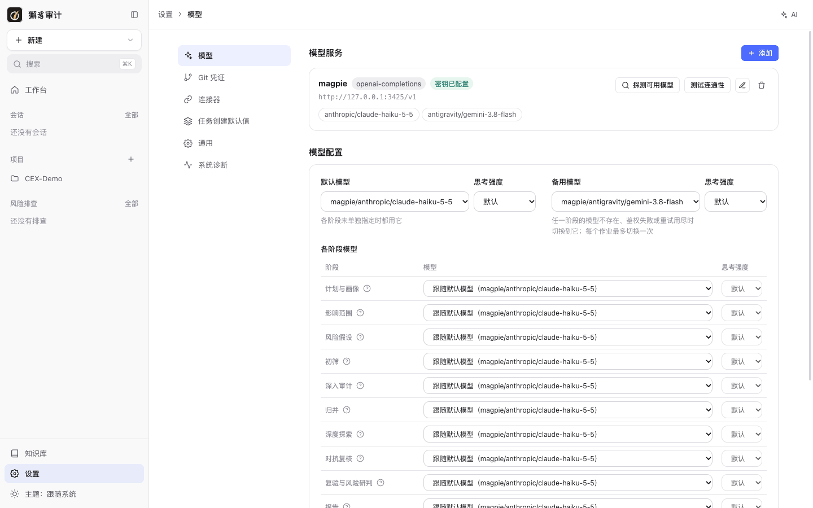
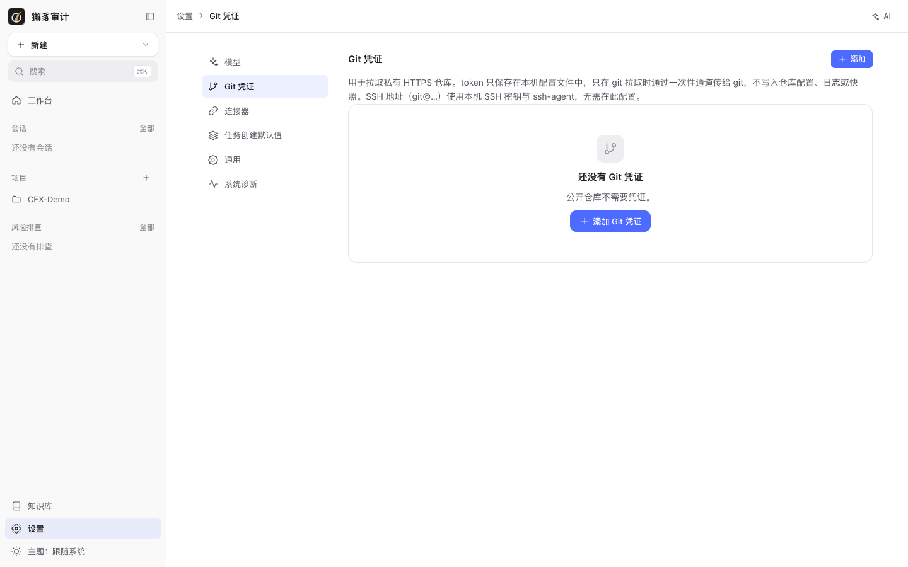
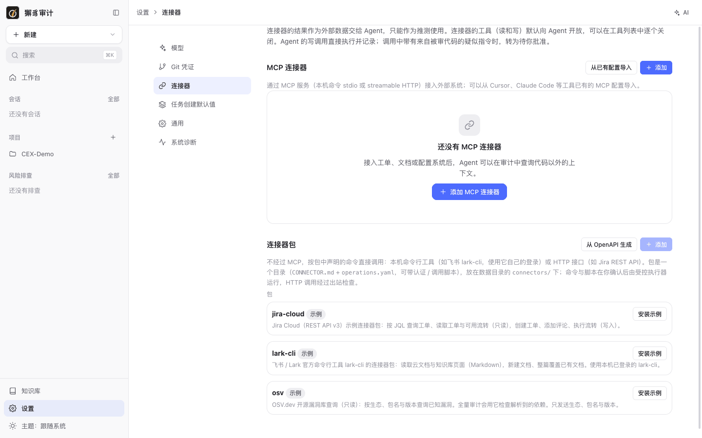
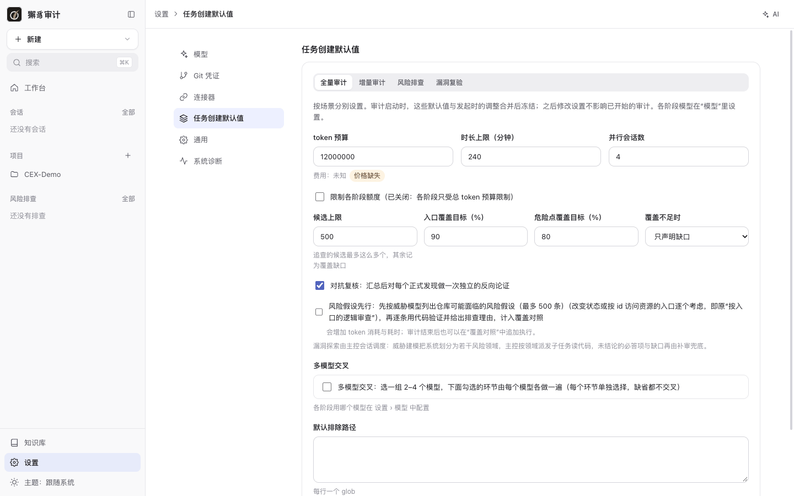
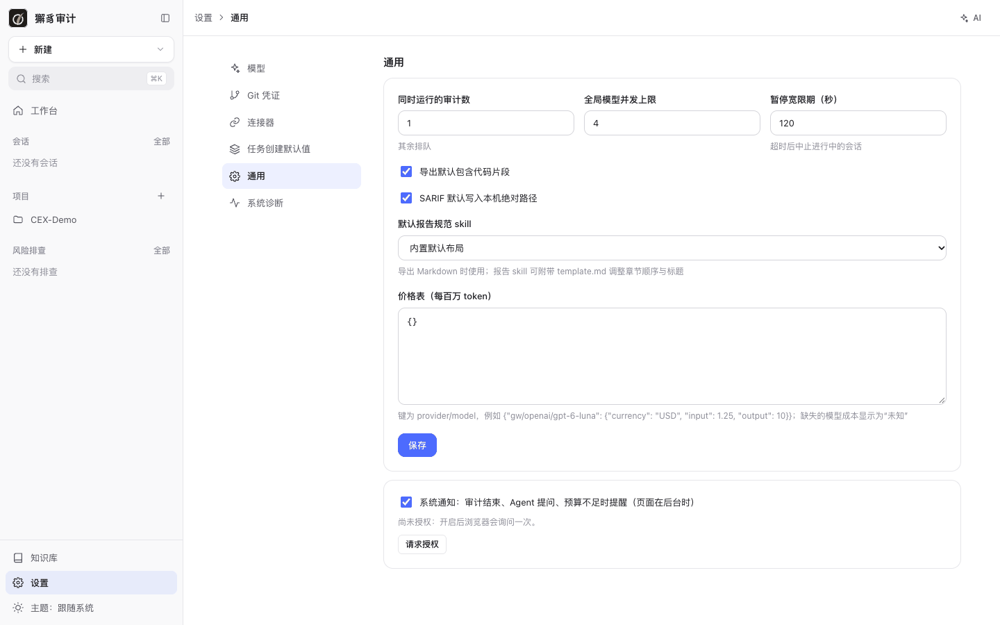
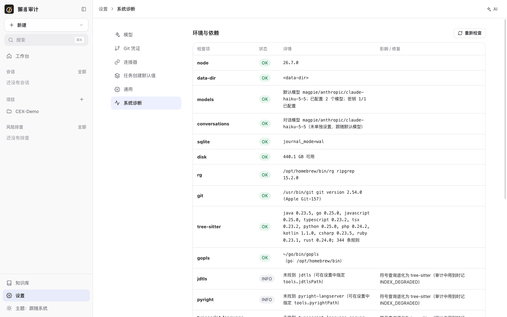

# 10. 设置

[← 返回目录](README.md)

侧栏 **设置** 下有六个分区：模型、Git 凭证、连接器、任务创建默认值、通用、系统诊断。

## 模型



### 模型服务

每个模型服务卡片显示服务 ID、协议、地址、密钥是否已配置，以及已启用的模型。卡片上的操作：

- **探测可用模型**：重新列出服务端的模型。
- **测试连通性**：检查地址、密钥和每个模型是否可用。
- 编辑、删除。

添加模型服务的步骤见 [第 1 章](01-install-and-setup.md#配置模型服务)。

### 模型配置

| 设置 | 说明 |
| --- | --- |
| 默认模型 + 思考强度 | 各阶段没有单独指定时都用它。 |
| 备用模型 + 思考强度 | 任一阶段的模型不存在、鉴权失败或重试用尽时切换到它；每个作业最多切换一次。 |
| 各阶段模型 | 计划与画像、影响范围、风险假设、初筛、深入审计、归并、深度探索、对抗复核、复验与风险研判、报告。每个阶段可以“跟随默认模型”、选具体模型，部分阶段可以选“不使用模型（确定性处理）”。点 `?` 查看各阶段的作用。 |
| 多模型交叉 | 选一组 2–4 个模型，勾选的环节由每个模型各做一遍，用于交叉复核。 |

审计启动时会冻结当时的模型配置，之后修改不影响已开始的审计。新建审计时也可以只为本次审计覆盖这些设置。

## Git 凭证



用于拉取私有 HTTPS 仓库。token 只保存在本机配置文件中，只在 git 拉取时通过一次性通道传给 git，不写入仓库配置、日志或快照。SSH 地址（`git@…`）使用本机 SSH 密钥与 ssh-agent，不需要在这里配置。公共仓库不需要凭证。

命令行：

```bash
xiezhi config set-git-credential gitlab.example.com --username oauth2
```

```bash
xiezhi config remove-git-credential gitlab.example.com
```

## 连接器

连接器让 Agent 在审计、会话、威胁建模中查询代码以外的上下文（工单、文档、配置系统），或把漏洞推送到外部系统。



- 连接器的结果作为外部数据交给 Agent，只能作为推测使用。
- 连接器的工具（读和写）默认向 Agent 开放，可以在工具列表中逐个关闭。
- Agent 的写调用会直接执行并记录；调用中带有来自被审代码的疑似指令时，转为待你批准。

### MCP 连接器

通过 MCP 服务（本机命令 stdio 或 streamable HTTP）接入外部系统。点 **添加** 手动配置，或点 **从已有配置导入**，从 Cursor、Claude Code 等工具已有的 MCP 配置导入。

### 连接器包

不经过 MCP，按包中声明的命令直接调用本机命令行工具（如飞书 `lark-cli`，使用它自己的登录），或调用 HTTP 接口（如 Jira REST API）。包是一个目录（`CONNECTOR.md` + `operations.yaml`，可以带认证 / 调用脚本），放在数据目录的 `connectors/` 下。命令和脚本在你确认后由受控执行器运行，HTTP 调用会经过出站检查。

内置三个示例包，点 **安装示例** 即可使用：

| 包 | 说明 |
| --- | --- |
| `jira-cloud` | Jira Cloud（REST API v3）：按 JQL 查询工单、读取工单与可用流转（只读）；创建工单、添加评论、执行流转（写）。 |
| `lark-cli` | 飞书 / Lark 官方命令行工具：读取云文档与知识库页面（Markdown），新建文档、整篇覆盖已有文档。 |
| `osv` | OSV.dev 开源漏洞库查询（只读）：按生态、包名与版本查询已知漏洞。全量审计会用它检查解析到的依赖，只发送生态、包名与版本。 |

也可以点 **从 OpenAPI 生成**，用接口描述文件生成连接器包。

## 任务创建默认值



按场景（全量审计、增量审计、风险排查、漏洞复验）分别设置。审计启动时，这些默认值与发起时的调整合并后冻结；之后修改设置不影响已开始的审计。

| 设置 | 全量审计默认值 | 说明 |
| --- | --- | --- |
| token 预算 | 12,000,000 | 配置价格表后显示预计费用。 |
| 时长上限（分钟） | 240 | |
| 并行会话数 | 4 | |
| 限制各阶段额度 | 关闭 | 关闭时各阶段只受总预算限制。 |
| 候选上限 | 500 | 超出的候选记为覆盖缺口。 |
| 入口 / 危险点覆盖目标（%） | 90 / 80 | |
| 覆盖不足时 | 只声明缺口 | 或“补齐：再追查未覆盖的候选”。 |
| 对抗复核 | 开启 | |
| 风险假设先行 | 关闭 | |
| 多模型交叉 | 关闭 | |
| 默认排除路径 | 空 | 每行一个 glob。 |

## 通用



| 设置 | 说明 |
| --- | --- |
| 同时运行的审计数 | 默认 1，其余排队。 |
| 全局模型并发上限 | 默认 4。 |
| 暂停宽限期（秒） | 默认 120，暂停后超过这个时间会中止进行中的会话。 |
| 导出默认包含代码片段 | |
| SARIF 默认写入本机绝对路径 | |
| 默认报告规范 skill | 导出 Markdown 时使用；报告 skill 可以附带 `template.md` 调整章节顺序与标题。 |
| 价格表（每百万 token） | JSON，键为 `provider/model`，例如 `{"gw/openai/gpt-6-luna": {"currency": "USD", "input": 1.25, "output": 10}}`。缺失的模型成本显示为“未知”。 |
| 系统通知 | 审计结束、Agent 提问、预算不足时提醒（页面在后台时）。需要浏览器允许通知。 |

## 系统诊断



与 `xiezhi doctor` 相同的检查，在界面中展示：Node、数据目录、模型配置、会话模型、SQLite、磁盘、rg、git、tree-sitter、各语言服务器。每项给出状态（OK / WARN / INFO）、详情和影响 / 修复建议。点 **重新检查** 刷新。

下一步：[11. 命令行参考](11-cli.md)
